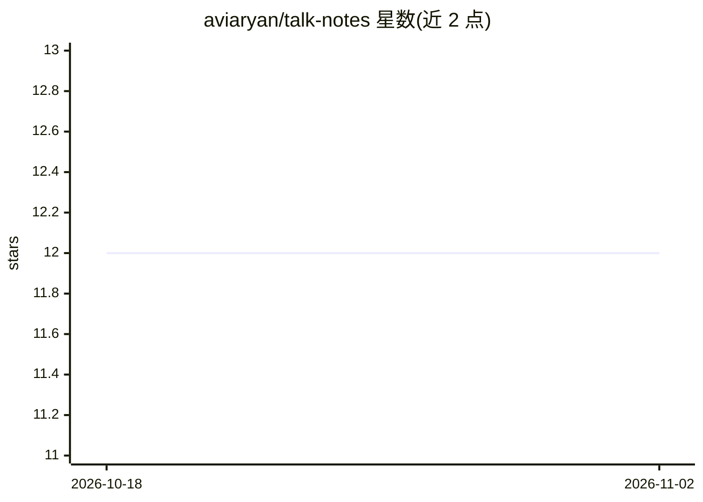

# aviaryan/talk-notes

⭐ 12 · Python · MIT · 推送 2026-01-25 · [GitHub](https://github.com/aviaryan/talk-notes) · 个人维护

**本地 RAG 对话应用：用自然语言与 Obsidian 笔记问答**

面向 Obsidian 用户的笔记问答应用：将 Markdown 笔记切块并用 BGE 模型本地生成嵌入，FAISS 构建向量库；提问时做带新近度加权的语义检索，将上下文注入提示词由 LLM 生成回答。LLM 可选 Google Gemini 或通过 Ollama 完全本地运行（嵌入始终本地）。基于 LangGraph 开发服务器提供 Web 聊天界面，使用 uv 管理 Python 依赖，需 Python 3.12+。

## 筛选速览

| 维度 | 判定 | 备注 |
|---|---|---|
| AI 角色 | `ai-native` | 本体是模型或模型工具 |
| 许可风险 | `permissive` | MIT |
| 部署形态 | `None` |  |
| 模型依赖 | local-ok | 支持本地模型 |
| 硬件要求 | — | 无带数字的原话,不猜 |
| 安装摩擦 | `low` | 无编译、无系统依赖或容器化 |
| 成熟度 | — | 结构信号不足 |

## 能力要点

- BGE 本地嵌入 + FAISS 向量检索
- 检索结果按笔记修改时间做新近度加权
- LLM 可选 Gemini 或 Ollama 完全本地运行
- 通过 LangGraph dev server 提供 Web 聊天界面

## 适用场景

- 向自己的 Obsidian 笔记库提问并获取基于笔记的回答
- 在不上传笔记内容的前提下做本地语义检索问答
- 结合最近修改的笔记获得时效性更强的回答

## 场景标签

`文档问答` · 领域:知识与检索

## 证据(README 行号)

> L3: A conversational AI assistant that lets you chat with your Obsidian notes using RAG (Retrieval-Augmented Generation)
> L134: 3. **Generation**: The retrieved context is injected into the prompt, and the LLM (Gemini or Ollama) generates a r

## 星数曲线

2026-10-18 12 → 2026-11-02 12（+0）

---
*卡片 v1 · prompt 1.4 · 生成 2026-11-01 · 置信度 high · 依据 README sha `a9735caeadb3` · [字段定义](../../DATASET.md)*
