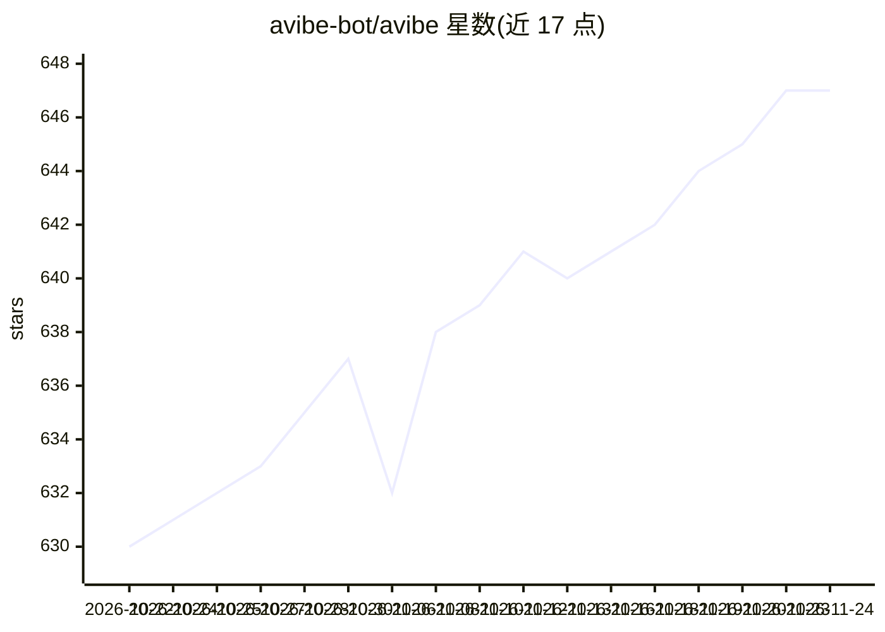

# avibe-bot/avibe

⭐ 647 · Python · MIT · 推送 2026-11-22 · [GitHub](https://github.com/avibe-bot/avibe) · [官网](https://avibe.bot) · 组织维护 · 中文 README

**让个人电脑成为本地 AI 伙伴之家的 Agent OS**

Avibe 是本地优先的 Agent OS：在用户自己的 Mac/Windows/Linux 机器上运行内置 AI 伙伴 Vibey，由 Bot（带长期记忆的常驻对话角色）调度多个 Agent 并行执行任务，输出实时网页、文件整理结果或后台监控通知。通过 Model Hub 接入已有订阅或 API key，多个凭证可按额度自动切换；Vault 机制让 Agent 按名取用密钥而不接触明文。支持 Skills、MCP、定时任务与 macOS Computer Use；手机端仅作远程访问，不具备独立运行能力。

## 筛选速览

| 维度 | 判定 | 备注 |
|---|---|---|
| AI 角色 | `ai-native` | 本体是模型或模型工具 |
| 许可风险 | `permissive` | MIT |
| 部署形态 | `None` |  |
| 模型依赖 | locked-api |  |
| 硬件要求 | — | 无带数字的原话,不猜 |
| 安装摩擦 | `low` | 无编译、无系统依赖或容器化 |
| 成熟度 | — | 结构信号不足 |

## 能力要点

- 内置 AI 伙伴 Vibey，本地文件与密钥留在本机
- Model Hub 支持订阅登录与多凭证额度切换
- Vault 密钥托管，Agent 按名取用不见明文
- 可直接运行 Claude Code/Codex/OpenCode CLI 并在其间分发任务

## 适用场景

- 让 AI 伙伴在本地长期记忆工作内容并主动汇报
- 用对话驱动文件整理、定时简报与网页监控
- 开发者把编码任务分发给 Claude Code/Codex 并跟踪结果
- 通过手机/聊天工具远程访问家中电脑上的 Bots

## 场景标签

`AI 助手` `Agent 记忆` `GUI 自动化` `编码 Agent` · 领域:Agent 开发

## 证据(README 行号)

> L7: Avibe is the local-first Agent OS: it turns your own Mac or PC into a home for AI partners, where they live and work
> L97: On long work, Vibey keeps hold of what you asked for and why. Long conversations force any AI to shorten what it re
> L118: Sign in with a Claude or ChatGPT subscription, or add API keys, and every Bot and Agent can use them. Line up more

## 星数曲线

2026-10-22 630 → 2026-11-24 647（+17）

---
*卡片 v1 · prompt 1.4 · 生成 2026-11-24 · 置信度 high · 依据 README sha `e54f7e115a1d` · [字段定义](../../DATASET.md)*
