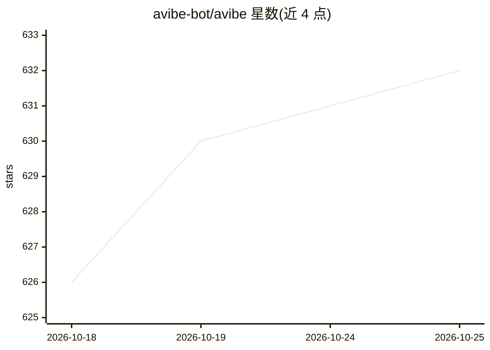

# avibe-bot/avibe

⭐ 632 · Python · MIT · 推送 2026-10-24 · [GitHub](https://github.com/avibe-bot/avibe) · [官网](https://avibe.bot) · 组织维护 · 中文 README

**本地优先的 Agent OS：在自有机器上运行并远程操控多个官方编码 agent**

Avibe 在用户本机运行官方 Claude Code、Codex、OpenCode CLI 及内置 agent Vibey，通过浏览器 Workbench 或 Slack/Discord/Telegram/微信/飞书等聊天应用远程操控。Model Hub 将多个订阅与 API key 汇聚到本地网关，支持跨 agent 混配模型、按序故障转移与用量统计；Agent Harness 提供 run/schedule/watch/inspect 四种原语支持后台任务；Show Pages 以网页形式返回结果；Vaults 按名保管密钥。一行 curl 脚本安装，Windows 推荐 WSL。

## 筛选速览

| 维度 | 判定 | 备注 |
|---|---|---|
| AI 角色 | `ai-ecosystem` | LLM/agent 周边工具 |
| 许可风险 | `permissive` | MIT |
| 部署形态 | `library` | 以包/库形式分发 |
| 模型依赖 | — | README 未给出锁定关系 |
| 硬件要求 | — | 无带数字的原话,不猜 |
| 安装摩擦 | `low` | 无编译、无系统依赖或容器化 |
| 成熟度 | — | 结构信号不足 |

## 能力要点

- 运行官方 Claude Code / Codex / OpenCode CLI 于统一 Agent 注册表
- Model Hub 本地网关汇聚订阅与 API key，跨 agent 混配模型并自动故障转移
- Agent Harness 提供运行/定时/监视/检查四种后台任务原语
- 支持浏览器、Slack、Discord、Telegram、微信、飞书多渠道接入

## 适用场景

- 离开工位后通过手机聊天应用继续操控本机的编码 agent
- 把多个 AI 订阅和 API key 汇聚到一个网关统一调度
- 让 agent 定时执行检查任务并在失败时通知

## 场景标签

`编码 Agent` `模型网关` · 领域:Agent 开发

## 证据(README 行号)

> L24: Avibe ships its own official agent, **Vibey**: built in, always on, nothing extra to install. Add a model source to
> L43: **One command, and your machine becomes the home your AI partner lives in.** Drive the *official* Claude Code, Code
> L69: Sign in each subscription and add each API key once — official vendors, relays, aggregators, self-hosted endpoints,

## 星数曲线

2026-10-18 626 → 2026-10-25 632（+6）

---
*卡片 v1 · prompt 1.4 · 生成 2026-10-21 · 置信度 mid · 依据 README sha `bf775fc6e015` · [字段定义](../../DATASET.md)*
