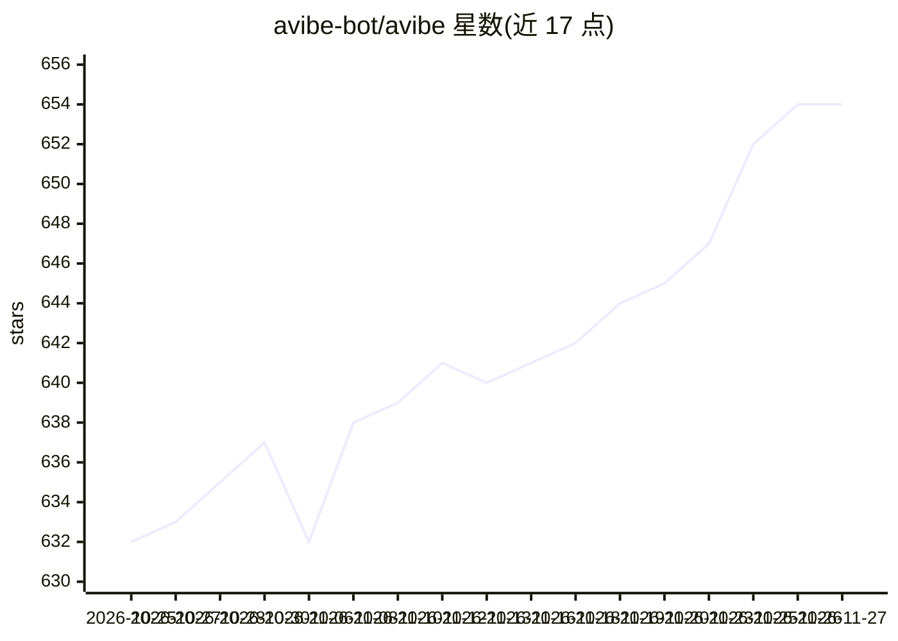

# avibe-bot/avibe

⭐ 654 · Python · MIT · 推送 2026-11-26 · [GitHub](https://github.com/avibe-bot/avibe) · [官网](https://avibe.bot) · 组织维护 · 中文 README

**把个人电脑变成 AI 伙伴之家的本地优先 Agent OS**

Avibe 是一个本地优先的 Agent OS：将 Mac/Windows/Linux 机器变成 AI 伙伴的运行环境，内置伙伴 Vibey 具备长期记忆、定时与后台任务、文件操作、Show Pages 输出、密码保险库（Vault）与 MCP/Skills 扩展。用户通过桌面应用、iPhone 应用、浏览器或 Slack/Discord/Telegram/WeChat/Lark 等聊天应用访问同一实例。模型接入依赖用户已有的 Claude/ChatGPT 订阅或 API key，MIT 许可、免费，桌面安装包免额外依赖，Linux/macOS/Windows 另有命令行安装脚本。

## 筛选速览

| 维度 | 判定 | 备注 |
|---|---|---|
| AI 角色 | `ai-native` | 本体是模型或模型工具 |
| 许可风险 | `permissive` | MIT |
| 部署形态 | `None` |  |
| 模型依赖 | locked-api |  |
| 硬件要求 | — | 无带数字的原话,不猜 |
| 安装摩擦 | `low` | 无编译、无系统依赖或容器化 |
| 成熟度 | — | 结构信号不足 |

## 能力要点

- 内置 AI 伙伴 Vibey，开箱即用，带长期记忆与最多 5 个自定义 Bot
- Vault 机制向 Agent 按名提供密码/密钥而不暴露值，签名类密钥本地签名
- 官方 Claude Code、Codex、OpenCode、Antigravity CLI 可不经修改并行运行
- 多端访问：桌面应用、iPhone（TestFlight beta）、浏览器与五种聊天应用

## 适用场景

- 让 AI 伙伴长期驻留在个人电脑上做定时汇报与后台监控
- 在本地文件上执行整理、上传等实际操作并由 Agent 代为完成
- 已有 Claude Code/Codex 工作流的开发者让 Vibey 分派与汇总编码任务
- 通过手机或聊天应用远程查看与指挥家中电脑上的 Agent

## 场景标签

`Agent 记忆` `AI 助手` · 领域:Agent 开发

## 证据(README 行号)

> L7: Avibe is the local-first Agent OS: it turns your own Mac or PC into a home for AI partners, where they live and work
> L116: ### Model Hub: the plans you already pay for
> L187: **Bring your coding agents.** The official Claude Code, Codex, OpenCode, and Antigravity CLIs run unchanged next t

## 星数曲线

2026-10-25 632 → 2026-11-27 654（+22）

---
*卡片 v1 · prompt 1.4 · 生成 2026-11-27 · 置信度 high · 依据 README sha `c991583e97de` · [字段定义](../../DATASET.md)*
