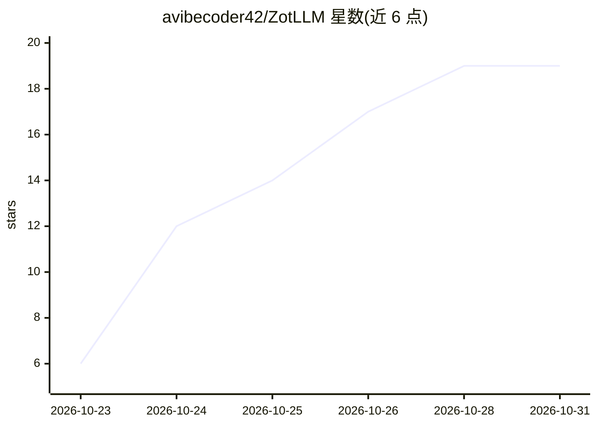

# avibecoder42/ZotLLM

⭐ 19 · Python · MIT · 推送 2026-10-29 · [GitHub](https://github.com/avibecoder42/ZotLLM) · 个人维护

**对个人 Zotero 文献库做语义问答与文献综述的桌面应用**

Windows 桌面应用，与 Zotero 并行工作：通过 Zotero 本地 API 读取 PDF/Word/EPUB 等文本与页码，在本机索引与嵌入，按项目组织知识语料库。提供带页码级引用的问答、引用逐条核验的文献综述，以及不依赖语言模型的库内搜索。语言模型可选用 Claude/ChatGPT/Gemini/DeepSeek API 或本地 Ollama；嵌入模型内置 llama.cpp 运行。限制：安装包未代码签名，需 WebView2 运行时；项目声明由 Claude 编写、未经人类逐行审查。

## 筛选速览

| 维度 | 判定 | 备注 |
|---|---|---|
| AI 角色 | `ai-native` | 本体是模型或模型工具 |
| 许可风险 | `permissive` | MIT |
| 部署形态 | `desktop` | 安装包/桌面程序 |
| 模型依赖 | local-ok | 支持本地模型 |
| 硬件要求 | — | 无带数字的原话,不猜 |
| 安装摩擦 | `low` | 无编译、无系统依赖或容器化 |
| 成熟度 | — | 结构信号不足 |

## 能力要点

- 问答引用可下钻到 PDF 具体页码的原文段落
- 文献综述的每条引用与逐字引文对照 PDF 核验
- 内置 llama.cpp 运行嵌入模型，索引与密钥均存本机（密钥加密存于系统密钥库）
- 支持不依赖语言模型的库内高级搜索与 Word/BibTeX/RIS 导出

## 适用场景

- 对自己的 Zotero 文献库提问并得到可溯源到页码的回答
- 生成引用经过核验的文献综述草稿
- 在本地模型（Ollama/内置嵌入）下完成检索问答，文献数据不出本机

## 场景标签

`科研工具` `RAG` `语义搜索` · 领域:知识与检索

## 证据(README 行号)

> L16:  Ask Questions about your own texts, answered only from the retrieved passages. Every citation opens the passage an
> L17:  Literature review From search strategy to a checked synthesis: every citation and verbatim quotation is verified a
> L20: Language models are your choice: **Claude, ChatGPT (OpenAI), Gemini, DeepSeek** via API, or local models via

## 星数曲线

2026-10-23 6 → 2026-10-31 19（+13）

---
*卡片 v1 · prompt 1.4 · 生成 2026-10-28 · 置信度 mid · 依据 README sha `fe6b5eacfa95` · [字段定义](../../DATASET.md)*
