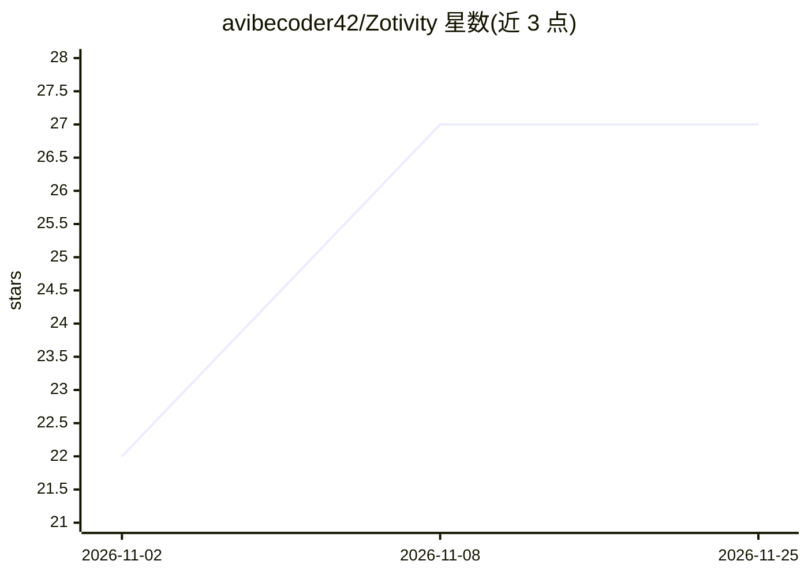

# avibecoder42/Zotivity

⭐ 27 · Python · MIT · 推送 2026-11-23 · [GitHub](https://github.com/avibecoder42/Zotivity) · 个人维护

**配合 Zotero 做文献检索、引用问答与文献综述的桌面应用**

Windows 桌面应用，与 Zotero 协同工作：通过 Zotero 本地 API 读取文献库的 PDF、Word 等文本，保留页码并在本地建立索引。功能覆盖学术数据库检索与 PRISMA 风格筛选、基于检索片段的带引用问答（引用可定位到原文页码）、逐条核对引文与原文的文献综述，以及无需语言模型的快速检索。语言模型可选 Claude、OpenAI、Gemini、DeepSeek、Mistral 的 API 或本地 Ollama，嵌入模型经内置 llama.cpp 在本地运行。面向科研用户；项目自述由 Claude 编写（约 350 个自动化测试，未经人工逐行审查），macOS/Linux 仅有准备好的路径与脚本。

## 筛选速览

| 维度 | 判定 | 备注 |
|---|---|---|
| AI 角色 | `ai-native` | 本体是模型或模型工具 |
| 许可风险 | `permissive` | MIT |
| 部署形态 | `desktop` | 安装包/桌面程序 |
| 模型依赖 | local-ok | 支持本地模型 |
| 硬件要求 | — | 无带数字的原话,不猜 |
| 安装摩擦 | `low` | 无编译、无系统依赖或容器化 |
| 成熟度 | `idea` | |

## 能力要点

- 检索片段式问答，引用可点击打开 PDF 对应页码
- 文献综述的每条引文与逐字引语对照 PDF 核验
- 学术数据库检索、去重池、筛选与 PRISMA 风格流程图
- 嵌入模型经内置 llama.cpp 本地运行，API 密钥存于系统密钥库

## 适用场景

- 在整理好的 Zotero 文献库上做带页码引用的问答
- 从研究问题出发完成数据库检索、筛选到综述的全流程
- 生成并核验引用逐条可溯的文献综述初稿

## 场景标签

`RAG` `语义搜索` `科研工具` · 领域:知识与检索

## 证据(README 行号)

> L11: **Zotivity** (formerly ZotLLM) is a desktop application that works alongside Zotero and enables **comprehensive sch
> L24:  Literature review From search strategy to a checked synthesis: every citation and verbatim quotation is verified a
> L27: Language models are your choice: **Claude, ChatGPT (OpenAI), Gemini, DeepSeek, Mistral** via API, or local models v

## 星数曲线

2026-11-02 22 → 2026-11-25 27（+5）

---
*卡片 v1 · prompt 1.4 · 生成 2026-11-18 · 置信度 mid · 依据 README sha `a9386b41e6cf` · [字段定义](../../DATASET.md)*
