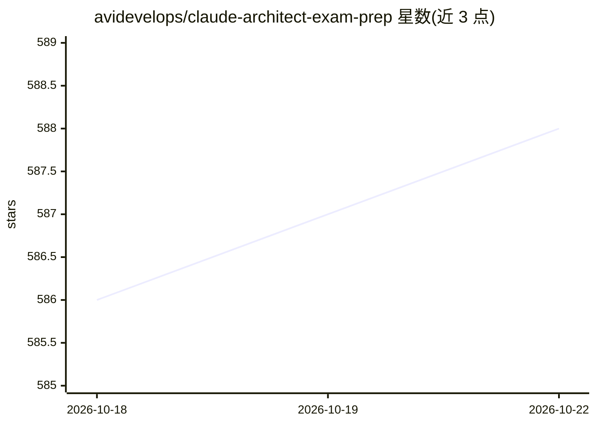

# avidevelops/claude-architect-exam-prep

⭐ 588 · NOASSERTION · 推送 2026-06-19 · [GitHub](https://github.com/avidevelops/claude-architect-exam-prep) · 个人维护

**Claude 认证架构师基础考试的备考问答指南**

整理自问答讨论的备考资料：围绕 Claude Certified Architect – Foundations 认证，按情景多选题形式拆解多智能体架构、上下文管理、工具与模式设计、批处理与状态管理等考点。每题给出正确答案、逐项排除理由与考试要点，内容涉及 Message Batches API 的 SLA 排程、结构化输出与溯源模式设计等权衡原则。以纯文档形式提供，面向准备该认证的工程师。

## 筛选速览

| 维度 | 判定 | 备注 |
|---|---|---|
| AI 角色 | `ai-knowledge` | 知识聚合/清单类 |
| 许可风险 | `none` | NOASSERTION |
| 部署形态 | `None` |  |
| 模型依赖 | — | README 未给出锁定关系 |
| 硬件要求 | — | 无带数字的原话,不猜 |
| 安装摩擦 | `low` | 无编译、无系统依赖或容器化 |
| 成熟度 | — | 结构信号不足 |

## 能力要点

- 情景式多选题 + 逐项排除理由 + 考试要点的结构
- 覆盖智能体架构、上下文管理、工具/模式设计、批处理与状态四类场景
- 强调确定性方案（schema 设计、工具边界）优先于概率式提示词工程

## 适用场景

- 准备 Claude Certified Architect – Foundations 认证考试
- 学习生产级 AI 系统的架构权衡与最佳实践
- 了解批处理 API 成本优化与 SLA 排程计算方法

## 场景标签

`教程课程` · 领域:学习与行业

## 证据(README 行号)

> L3: # Claude Certified Architect – Foundations: Exam Prep Guide
> L6: This guide is compiled from a detailed Q&A thread analyzing exam-style questions for the **Claude Certified Architec
> L9: The Claude Architect Foundations exam tests your ability to design resilient, production-ready AI systems. It consis

## 星数曲线

2026-10-18 586 → 2026-10-22 588（+2）

---
*卡片 v1 · prompt 1.4 · 生成 2026-10-21 · 置信度 high · 依据 README sha `d0b7477e5b13` · [字段定义](../../DATASET.md)*
