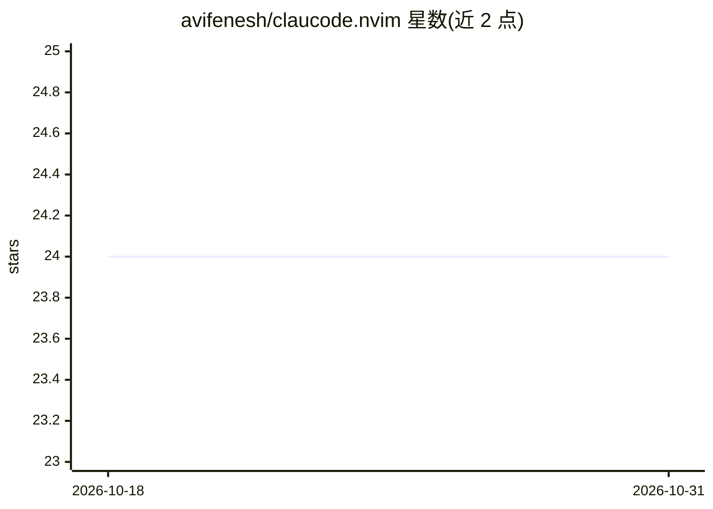

# avifenesh/claucode.nvim

⭐ 24 · Lua · MIT · 推送 2026-10-22 · [GitHub](https://github.com/avifenesh/claucode.nvim) · 个人维护

**连接 Neovim 与 Claude Code CLI 的桥接插件**

Neovim 插件，自身不实现 AI，而是调用已安装的 Claude Code CLI：在编辑器内发送提示词、以弹窗流式展示回答或以终端分屏交互；内置 MCP 服务器提供 side-by-side diff 预览，Claude 的文件修改须经用户按 a 接受或 r 拒绝后才写入，并可运行时切换 auto-accept 直通模式。支持多会话隔离的 MCP 服务器、文件变更自动重载 buffer、CLAUDE.md 自动注入说明。前置要求 Neovim 0.10+、Claude Code CLI 与 ANTHROPIC_API_KEY 或已登录会话。

## 筛选速览

| 维度 | 判定 | 备注 |
|---|---|---|
| AI 角色 | `ai-ecosystem` | LLM/agent 周边工具 |
| 许可风险 | `permissive` | MIT |
| 部署形态 | `library` | 以包/库形式分发 |
| 模型依赖 | locked-api |  |
| 硬件要求 | — | 无带数字的原话,不猜 |
| 安装摩擦 | `low` | 无编译、无系统依赖或容器化 |
| 成熟度 | — | 结构信号不足 |

## 能力要点

- MCP 驱动的 side-by-side diff 预览，修改须用户批准后写入
- 每个 Neovim 实例按项目目录获得隔离的 MCP 服务器
- 终端分屏集成与弹窗流式响应
- 运行时 :ClaudeAutoAccept 切换免审直通模式

## 适用场景

- 在 Neovim 内直接向 Claude Code 发送提示词并查看回答
- 在 Claude 修改文件前审查并批准每处改动
- 对选中代码片段做解释或生成测试

## 场景标签

`编码 Agent` · 领域:编码与开发

## 证据(README 行号)

> L9: A lightweight Neovim plugin that bridges your editor with Claude Code CLI, bringing AI assistance directly into your
> L249: - 🤖 An AI implementation (Claude handles that)
> L253: It's a simple bridge - Claude does the AI work, this plugin handles the communication.

## 星数曲线

2026-10-18 24 → 2026-10-31 24（+0）

---
*卡片 v1 · prompt 1.4 · 生成 2026-10-27 · 置信度 mid · 依据 README sha `6b95459f76b1` · [字段定义](../../DATASET.md)*
