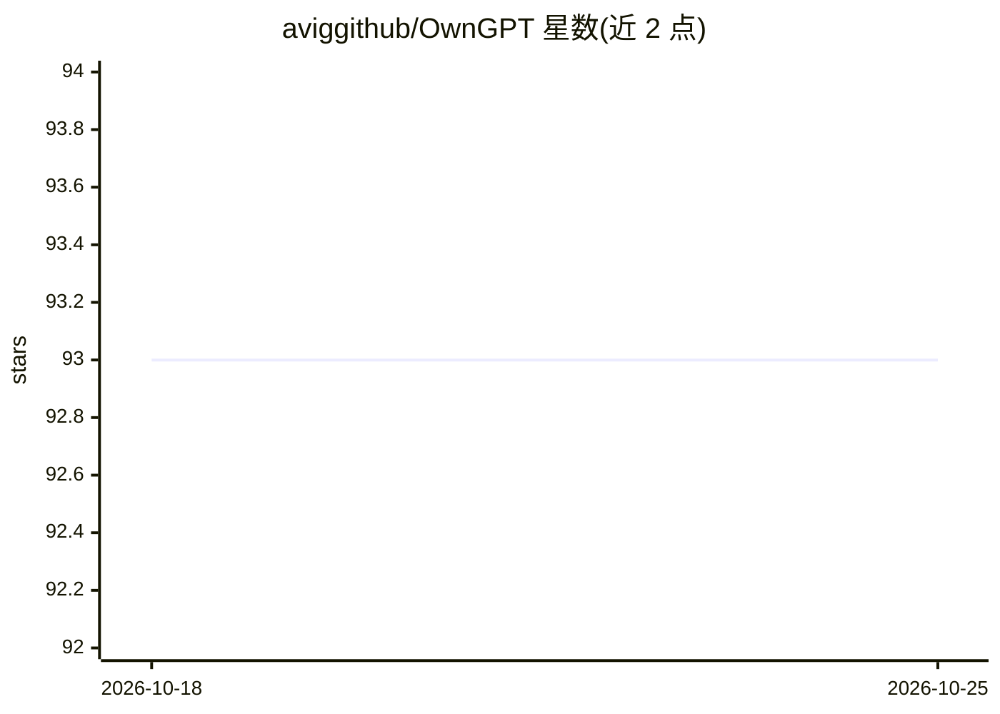

# aviggithub/OwnGPT

⭐ 93 · Python · 推送 2025-11-12 · [GitHub](https://github.com/aviggithub/OwnGPT) · 个人维护

**本地私有文档问答应用：用本地 LLM 与向量库在自有设备上问答**

受 privateGPT 启发的本地文档问答项目：通过 ingest.py 解析 source_documents 中的文档（支持 CSV/PDF/DOCX/EPUB 等 12 种格式），用 InstructorEmbeddings 生成嵌入并存入 Chroma 本地向量库；再以 Streamlit UI 启动界面，使用本地 LLM（ggml-gpt4all-j-v1.3-groovy.bin）结合相似度检索回答用户提问，全程无需联网且数据不离开本机。可替换为 HuggingFace 格式的其他 LLM。README 声明这是验证可行性的测试项目，非生产就绪。

## 筛选速览

| 维度 | 判定 | 备注 |
|---|---|---|
| AI 角色 | `ai-native` | 本体是模型或模型工具 |
| 许可风险 | `none` | — |
| 部署形态 | `library` | 以包/库形式分发 |
| 模型依赖 | — | README 未给出锁定关系 |
| 硬件要求 | — | 无带数字的原话,不猜 |
| 安装摩擦 | `medium` | 含编译或系统依赖之一 |
| 成熟度 | `idea` | |

## 能力要点

- 支持 12 种文档格式的本地摄取与向量化（Chroma 向量库 + InstructorEmbeddings）
- Streamlit UI 本地问答，首次运行后可完全离线使用
- 默认使用 ggml-gpt4all-j-v1.3-groovy.bin，可替换为任意 HF 格式 LLM
- 要求 Python 3.10.0 及以上；pip 安装构建 wheel 失败时需安装 C++ 编译器

## 适用场景

- 在离线环境下对自己的文档提问并获得答案
- 在不让数据离开本地设备的前提下搭建私有知识问答
- 用 HuggingFace 上的其他本地模型替换默认 LLM 做文档问答

## 场景标签

`文档问答` · 领域:知识与检索

## 证据(README 行号)

> L2: Create Own ChatGPT with your documents using streamlit UI on your own device using GPT models. No data leaves your d
> L6: Ask questions to your documents without an internet connection, using the power of LLMs. 100% private, no data leave
> L67: - `streamlit run owngpt.py` uses a local LLM (ggml-gpt4all-j-v1.3-groovy.bin) to understand questions and create an

## 星数曲线

2026-10-18 93 → 2026-10-25 93（+0）

---
*卡片 v1 · prompt 1.4 · 生成 2026-10-24 · 置信度 high · 依据 README sha `6628ef98ed24` · [字段定义](../../DATASET.md)*
