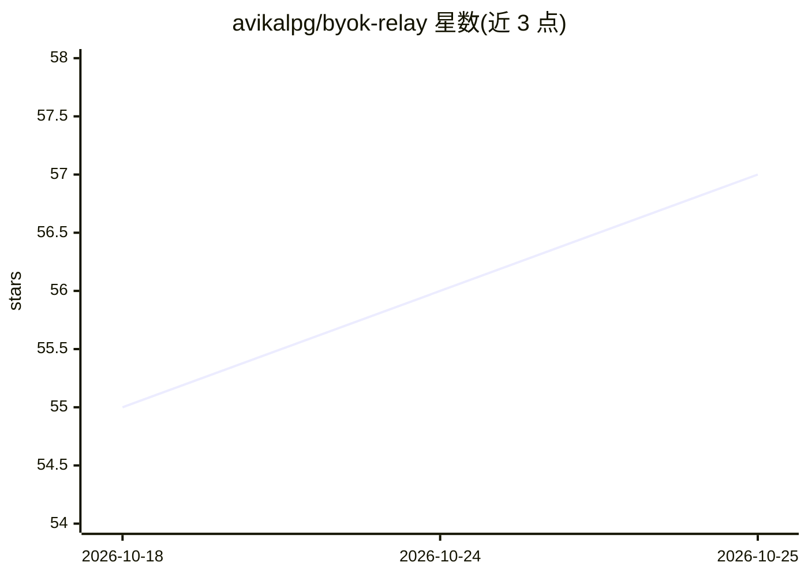

# avikalpg/byok-relay

⭐ 57 · JavaScript · Apache-2.0 · 推送 2026-09-20 · [GitHub](https://github.com/avikalpg/byok-relay) · [官网](https://byokrelay.com) · 个人维护

**BYOK 中继服务：让浏览器前端用用户自己的 AI 密钥直连 LLM，绕开 CORS**

面向轻量纯前端应用的 Bring Your Own Key 中继：浏览器因 CORS 无法直连 OpenAI/Anthropic 等 API，本服务为每个用户发放安全令牌，用户自存密钥、自付推理费用，开发者无需自建后端代理。提供托管 relay（免费、开放 CORS）或 3 条命令 Docker 自托管（非 Docker 方式需 Node 18+）。配套 React/Vue/Svelte/Solid/Angular/Preact/Remix/Astro/Vercel AI SDK 等集成包，含 SSE 流式聊天与健康检查。托管版明文中转请求体，仅建议用于原型与开发，生产需自托管。

## 筛选速览

| 维度 | 判定 | 备注 |
|---|---|---|
| AI 角色 | `ai-ecosystem` | LLM/agent 周边工具 |
| 许可风险 | `permissive` | Apache-2.0 |
| 部署形态 | `self-host` | docker 或自建部署 |
| 模型依赖 | locked-api |  |
| 硬件要求 | — | 无带数字的原话,不猜 |
| 安装摩擦 | `low` | 无编译、无系统依赖或容器化 |
| 成熟度 | — | 结构信号不足 |

## 能力要点

- 用户自带 API 密钥经中继调用 LLM，密钥不经开发者代码、成本记在用户账单
- 托管 relay 零配置可用，或 docker compose 3 命令自托管
- 提供 React/Vue/Svelte/Solid/Angular/Preact/Remix/Astro/Vercel AI SDK 集成包
- SSE 流式聊天、健康检查轮询，密钥仅存内存不落 localStorage

## 适用场景

- 纯前端应用接入 LLM 而无需自建后端代理
- 让用户用自己的 API 密钥与额度使用 AI 功能
- 在 Next.js/Vue/SvelteKit 等框架中快速添加 BYOK 聊天组件

## 场景标签

`模型网关` · 领域:Agent 开发

## 证据(README 行号)

> L15: > **Your users bring their own AI keys. byok-relay lets them use those keys straight from the browser — CORS handle
> L17: Browser apps can't call `api.openai.com` or `api.anthropic.com` directly — CORS blocks them. The usual fix (a backe

## 星数曲线

2026-10-18 55 → 2026-10-25 57（+2）

---
*卡片 v1 · prompt 1.4 · 生成 2026-10-24 · 置信度 high · 依据 README sha `252f698159ee` · [字段定义](../../DATASET.md)*
