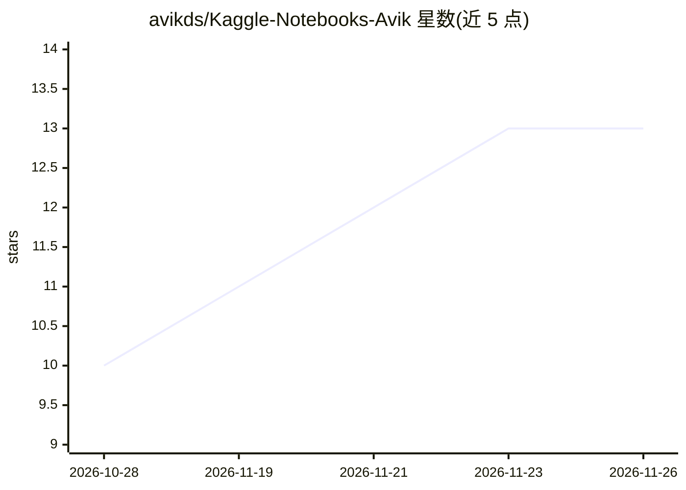

# avikds/Kaggle-Notebooks-Avik

⭐ 13 · Jupyter Notebook · 推送 2026-11-25 · [GitHub](https://github.com/avikds/Kaggle-Notebooks-Avik) · [官网](https://www.kaggle.com/avikdas567/code) · 个人维护

**面向科研与竞赛者的 Kaggle 笔记本合集（数据科学与 ML/DL 项目）**

作者个人 Kaggle 笔记本合集，按研究方向、黑客松、竞赛三类组织，覆盖高能物理、天体物理、材料信息学、电池健康、气候、金融、NLP 等主题，内容为端到端数据分析、特征工程、预测建模与竞赛解题过程。README 以目录列表形式呈现条目，未包含安装步骤、运行说明或代码使用指引，使用需跳转 Kaggle 平台查看对应笔记本。

## 筛选速览

| 维度 | 判定 | 备注 |
|---|---|---|
| AI 角色 | `ai-knowledge` | 知识聚合/清单类 |
| 许可风险 | `none` | — |
| 部署形态 | `library` | 以包/库形式分发 |
| 模型依赖 | — | README 未给出锁定关系 |
| 硬件要求 | — | 无带数字的原话,不猜 |
| 安装摩擦 | `low` | 无编译、无系统依赖或容器化 |
| 成熟度 | — | 结构信号不足 |

## 能力要点

- 收集数百个覆盖 AI/ML/深度学习主题的 Kaggle 笔记本
- 按研究方向、黑客松、竞赛三类组织条目
- 主题横跨物理、材料、地球科学、金融、NLP 等领域
- 多条黑客松条目附带 Writeup 文档

## 适用场景

- 查找物理或材料类数据科学项目的分析思路参考
- 学习 Kaggle 竞赛的端到端解题流程
- 浏览特定行业（能源、房地产、电商）的预测建模案例

## 场景标签

`科研工具` `教程课程` `精选清单` · 领域:学习与行业

## 证据(README 行号)

> L1: # Kaggle Notebooks
> L3: - Jet Flavour Identification on LHC: Deep Attentive Architectures for Multi-Class Hadron Tagging
> L144: # Hackathon Notebooks

## 星数曲线

2026-10-28 10 → 2026-11-26 13（+3）

---
*卡片 v1 · prompt 1.4 · 生成 2026-11-19 · 置信度 mid · 依据 README sha `d0227ccfb0ef` · [字段定义](../../DATASET.md)*
