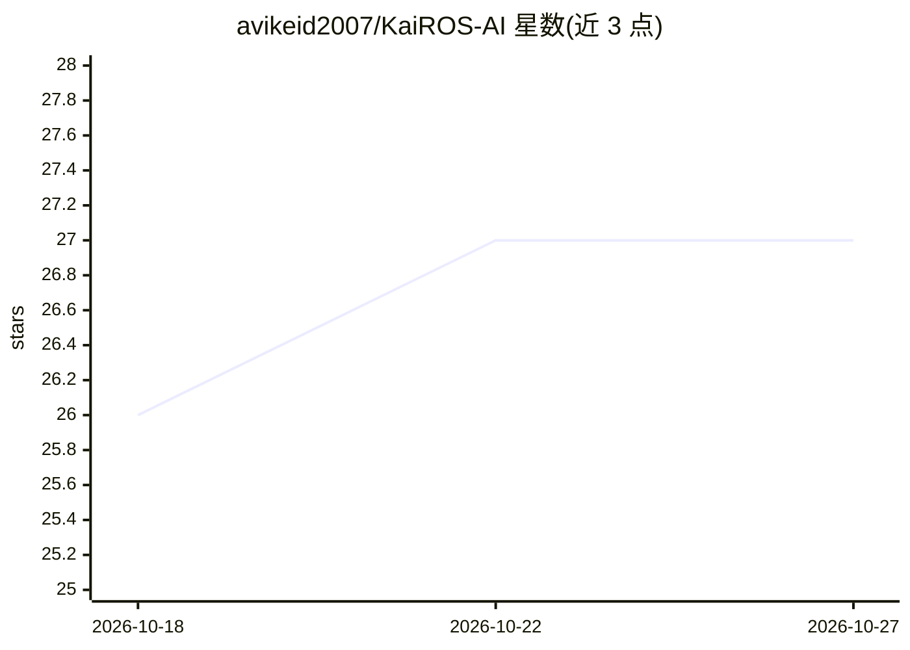

# avikeid2007/KaiROS-AI

⭐ 27 · C# · MIT · 推送 2026-10-07 · [GitHub](https://github.com/avikeid2007/KaiROS-AI) · [官网](https://avikeid2007.github.io/KaiROS-AI/) · 个人维护

**Windows/Android 本地 LLM 聊天助手，无需云端、隐私优先**

基于 .NET 9 的本地 AI 助手：桌面版用 WinUI 3、移动版用 .NET MAUI，通过 LLamaSharp 0.27 在设备上运行 GGUF 格式 LLM（Qwen、Gemma、LLaMA、Phi、Mistral 等 40+ 模型目录），支持视觉模型、本地 RAG 文档对话、联网搜索、CUDA 12 GPU 加速、预检 RAM 与动态上下文。桌面版另提供 OpenAI 兼容的本地 REST API 与 RAG-as-a-Service 端点。经 Microsoft Store/MSIX/APK 分发，自包含无需安装 .NET。旧 WPF 项目已停更，新功能只进 WinUI 版。

## 筛选速览

| 维度 | 判定 | 备注 |
|---|---|---|
| AI 角色 | `ai-native` | 本体是模型或模型工具 |
| 许可风险 | `permissive` | MIT |
| 部署形态 | `None` |  |
| 模型依赖 | — | README 未给出锁定关系 |
| 硬件要求 | — | 无带数字的原话,不猜 |
| 安装摩擦 | `medium` | 含编译或系统依赖之一 |
| 成熟度 | — | 结构信号不足 |

## 能力要点

- LLamaSharp 驱动的本地 GGUF 推理，40+ 预配置模型目录
- RAG 文档对话与 RAG-as-a-Service（每服务独立端口的本地知识库 API）
- OpenAI 兼容本地 REST API（/chat、/chat/stream SSE）
- CUDA 12 GPU 加速、硬件自动检测与预检 RAM 上下文动态调整

## 适用场景

- 在 Windows 或 Android 设备上离线运行 LLM 聊天
- 用本地 PDF/DOCX 等文档做 RAG 问答
- 通过本地 OpenAI 兼容 API 把本地模型接入 VS Code 或自研应用
- 为多份文档各建独立的 RAG 服务端点供代码调用

## 场景标签

`AI 助手` `聊天机器人` `文档问答` · 领域:对话与助手

## 证据(README 行号)

> L5:  A powerful local AI assistant for Windows & Android
> L42: |**Local LLM Inference**|✅|✅|
> L71: - **Local REST API** — OpenAI-compatible `/chat` endpoint for integration with VS Code (Continue), LM Studio, or cu

## 星数曲线

2026-10-18 26 → 2026-10-27 27（+1）

---
*卡片 v1 · prompt 1.4 · 生成 2026-10-26 · 置信度 high · 依据 README sha `6379bb0e42e4` · [字段定义](../../DATASET.md)*
