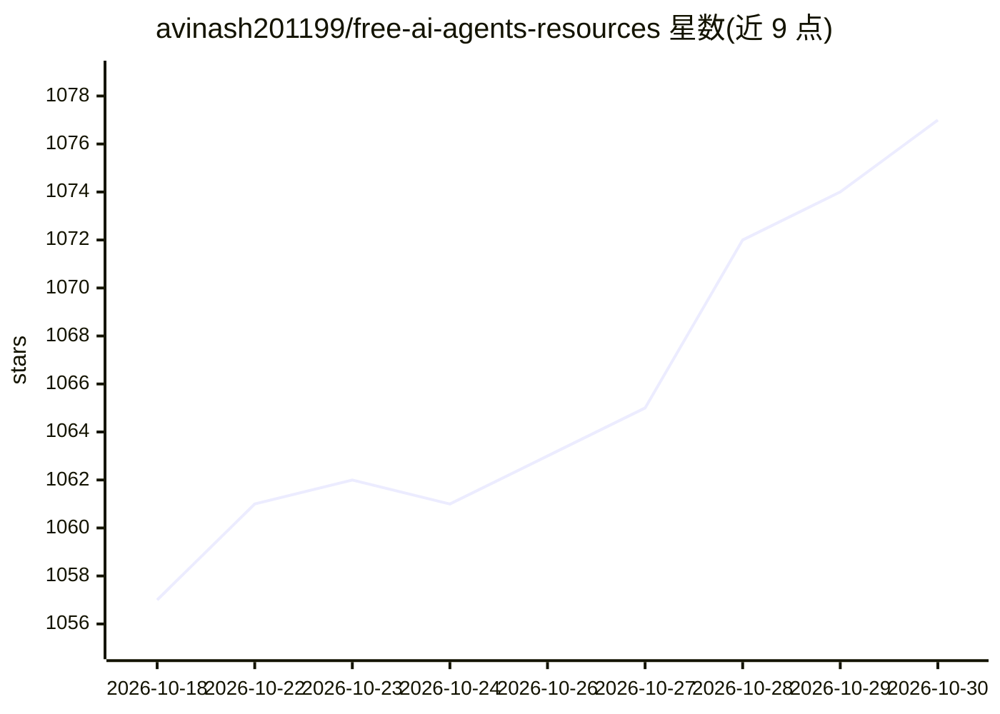

# avinash201199/free-ai-agents-resources

⭐ 1,077 · MIT · 推送 2026-02-28 · [GitHub](https://github.com/avinash201199/free-ai-agents-resources) · [官网](https://www.lets-code.co.in/) · 个人维护

**AI agent 免费学习资源策展清单：教程、框架、社区与课程**

面向初学者到进阶开发者的 AI agents 免费学习资源聚合清单：收录策展清单仓库、教学课程（Microsoft AI Agents for Beginners、NirDiamant/GenAI_Agents 等）、框架工具（LangChain、LangGraph、AutoGPT、OpenHands 等）、YouTube 课程与频道、官方网站与文档、免费模型平台（Hugging Face Hub、Replicate、Colab 等）、博客指南、社区论坛与免费书籍，按类别以表格组织并给出学习起点推荐。本体为静态编目，不提供代码运行或安装。

## 筛选速览

| 维度 | 判定 | 备注 |
|---|---|---|
| AI 角色 | `ai-knowledge` | 知识聚合/清单类 |
| 许可风险 | `permissive` | MIT |
| 部署形态 | `None` |  |
| 模型依赖 | — | README 未给出锁定关系 |
| 硬件要求 | — | 无带数字的原话,不猜 |
| 安装摩擦 | `low` | 无编译、无系统依赖或容器化 |
| 成熟度 | — | 结构信号不足 |

## 能力要点

- 覆盖课程、框架仓库、视频、文档、社区与书籍的分区清单
- Quick Start 按场景推荐入门资源
- 收录免费模型访问平台（Hugging Face Hub、Replicate、Colab 等）

## 适用场景

- 系统性查找 AI agent 的免费课程与教程
- 比较可用的 agent 框架与开源项目
- 加入 AI agent 开发者社区提问与交流

## 场景标签

`精选清单` · 领域:学习与行业

## 证据(README 行号)

> L3: A curated collection of **free and open-source resources** for learning and building AI agents (autonomous agents, L
> L18: ## 🐙 GitHub Repositories

## 星数曲线

2026-10-18 1,057 → 2026-10-30 1,077（+20）

---
*卡片 v1 · prompt 1.4 · 生成 2026-10-21 · 置信度 high · 依据 README sha `7e1102e54671` · [字段定义](../../DATASET.md)*
