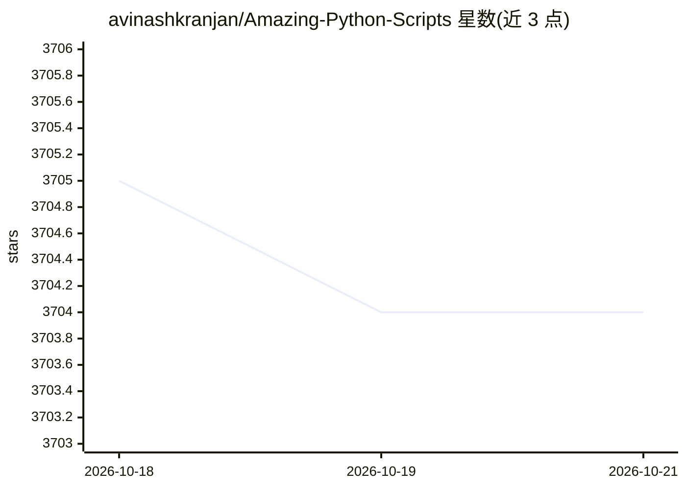

# avinashkranjan/Amazing-Python-Scripts

⭐ 3,704 · Jupyter Notebook · MIT · 推送 2026-02-20 · [GitHub](https://github.com/avinashkranjan/Amazing-Python-Scripts) · [官网](https://amazing-python-scripts.avinashranjan.com) · 个人维护

**Python 脚本合集：基础到进阶与自动化任务脚本策展**

由 avinashkranjan 维护的 Python 脚本策展仓库，收录从基础到进阶的脚本及自动化任务脚本，完整清单在 SCRIPTS.md 中列出。面向开发者与学习者，可用于查找 PDF 下载、社交平台自动化等实用脚本，也是个人提交新脚本的参与空间（Hacktoberfest 标签、贡献指南、Issue 认领流程）。脚本主题标签涉及机器学习、语音、摄像头等，但 README 未描述具体实现机制。

## 筛选速览

| 维度 | 判定 | 备注 |
|---|---|---|
| AI 角色 | `ai-knowledge` | 知识聚合/清单类 |
| 许可风险 | `permissive` | MIT |
| 部署形态 | `None` |  |
| 模型依赖 | — | README 未给出锁定关系 |
| 硬件要求 | — | 无带数字的原话,不猜 |
| 安装摩擦 | `low` | 无编译、无系统依赖或容器化 |
| 成熟度 | — | 结构信号不足 |

## 能力要点

- 策展式脚本合集，范围从基础到进阶与自动化任务
- 脚本清单集中列于 SCRIPTS.md
- 提供贡献指南与 Issue 认领流程，开放社区提交

## 适用场景

- 查找现成 Python 脚本解决自动化小任务
- 通过认领 Issue 和提交 PR 参与开源贡献
- 作为 Python 学习与练手项目来源

## 场景标签

`精选清单` · 领域:学习与行业

## 证据(README 行号)

> L16: A curated collection of **Amazing Python scripts** from **_Basics to Advance with automation task scripts_**. This 
> L19:  📃 Scripts Available

## 星数曲线

2026-10-18 3,705 → 2026-10-21 3,704（-1）

---
*卡片 v1 · prompt 1.4 · 生成 2026-10-20 · 置信度 mid · 依据 README sha `89fbbb9146c0` · [字段定义](../../DATASET.md)*
