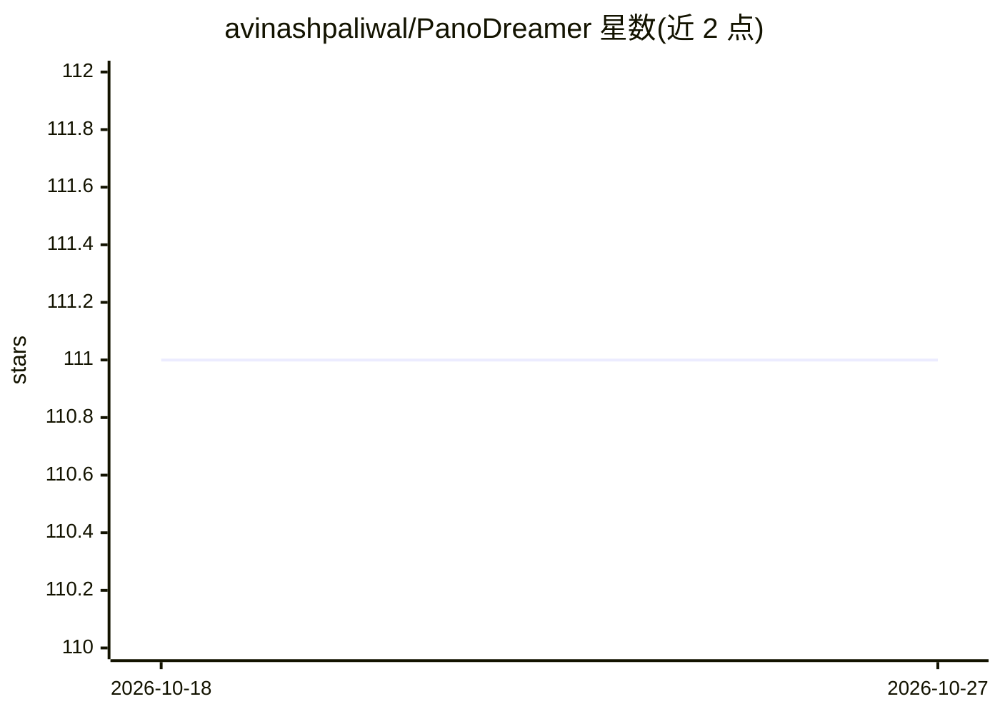

# avinashpaliwal/PanoDreamer

⭐ 111 · Python · 推送 2026-04-24 · [GitHub](https://github.com/avinashpaliwal/PanoDreamer) · [官网](https://people.engr.tamu.edu/nimak/Papers/PanoDreamer) · 组织维护

**单张图像生成 360° 全景与 3D 高斯泼溅场景的研究代码**

SIGGRAPH Asia 2025 论文的官方实现：从单张输入图像出发，基于扩散模型（MultiConDiffusion）在透视空间扩展图像并生成 360° 柱面全景，随后进行一致的深度估计（Depth-Anything-V2，可选 MoGe 校准）、分层深度图（LDI）生成与背景修复，最终优化出 3D Gaussian Splatting 场景并用 gsplat 渲染。以 Python 脚本形式提供六个独立阶段，通过 git clone 子模块方式安装，面向计算机图形学/视觉研究者。

## 筛选速览

| 维度 | 判定 | 备注 |
|---|---|---|
| AI 角色 | `ai-native` | 本体是模型或模型工具 |
| 许可风险 | `none` | — |
| 部署形态 | `None` |  |
| 模型依赖 | — | README 未给出锁定关系 |
| 硬件要求 | — | 无带数字的原话,不猜 |
| 安装摩擦 | `low` | 无编译、无系统依赖或容器化 |
| 成熟度 | — | 结构信号不足 |

## 能力要点

- MultiConDiffusion 扩散模型生成 360° 柱面全景
- 支持多种深度估计方法（dav2/moge 组合）
- LDI 分层与背景修复后优化 3DGS 场景
- 提供 3DGS 训练与渲染（gsplat）脚本

## 适用场景

- 从单张照片生成可环视的 360° 3D 场景
- 研究生成扩散模型与 3DGS 结合的论文复现
- 为新视角合成任务生成全景深度与场景数据

## 场景标签

`图像生成` · 领域:内容生成

## 证据(README 行号)

> L3: > PanoDreamer: Optimization-Based Single Image to 360° 3D Scene With Diffusion
> L20: This repository implements panorama generation and 3D scene creation:
> L23: - **`multicondiffusion_panorama.py`**: Generates a 360° cylindrical panorama

## 星数曲线

2026-10-18 111 → 2026-10-27 111（+0）

---
*卡片 v1 · prompt 1.4 · 生成 2026-10-23 · 置信度 high · 依据 README sha `3c5690fdba4a` · [字段定义](../../DATASET.md)*
