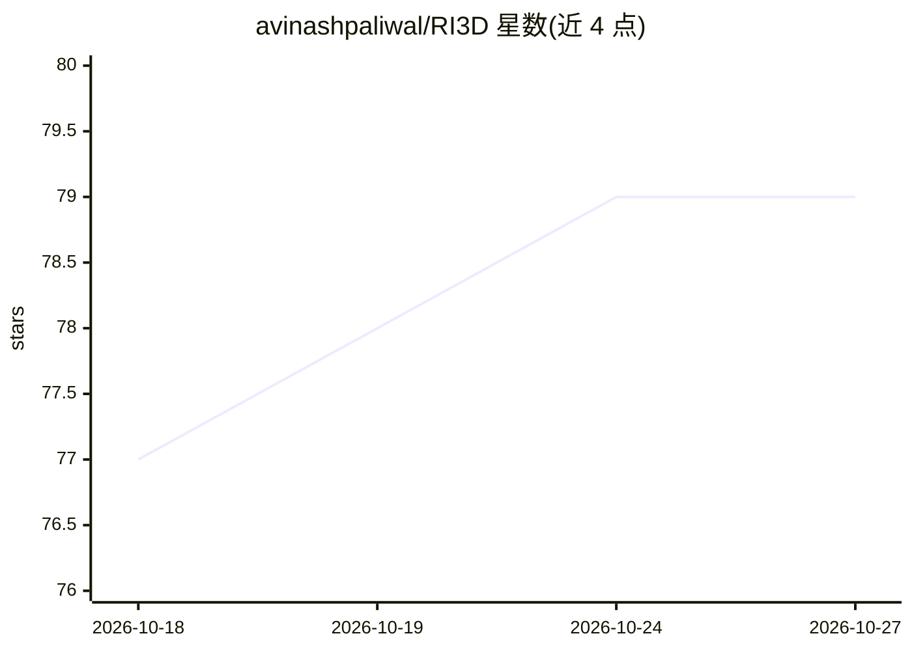

# avinashpaliwal/RI3D

⭐ 79 · Python · 推送 2026-04-23 · [GitHub](https://github.com/avinashpaliwal/RI3D) · [官网](https://people.engr.tamu.edu/nimak/Papers/RI3D) · 组织维护

**稀疏视角新视图重建方法：3DGS 结合修复/补全扩散先验**

ICCV 2025 论文的官方实现：从少量（3-9 张）输入图像重建高质量新视图。方法为两阶段优化的 3D Gaussian Splatting——先用微调 ControlNet+LoRA 的修复模型把可见区域渲染增强为伪真值，再用微调 Stable Diffusion inpainting 模型（RealFill）补全未观测区域，保持多视角一致性。提供预训练模型、mip-NeRF 360 数据集划分、渲染/评测/训练（5 阶段）脚本。测试环境 Ubuntu + NVIDIA 2080 Ti (CUDA 11.8)、Python 3.10，需从源码运行。

## 筛选速览

| 维度 | 判定 | 备注 |
|---|---|---|
| AI 角色 | `ai-native` | 本体是模型或模型工具 |
| 许可风险 | `none` | — |
| 部署形态 | `None` |  |
| 模型依赖 | — | README 未给出锁定关系 |
| 硬件要求 | — | 无带数字的原话,不猜 |
| 安装摩擦 | `medium` | 含编译或系统依赖之一 |
| 成熟度 | — | 结构信号不足 |

## 能力要点

- Repair 模型：ControlNet+LoRA 将可见区域渲染增强为伪真值
- Inpainting 模型：Stable Diffusion inpainting 补全未观测区域
- 两阶段优化保持多视角一致性
- 提供 mip-NeRF 360 全 9 场景预训练 3DGS 模型（3/6/9 视角）

## 适用场景

- 用少量照片重建场景并渲染新视角视频
- 在 mip-NeRF 360 上复现论文评测指标
- 研究稀疏视角 3D 重建中的扩散先验方法

## 场景标签

`图像生成` · 领域:内容生成

## 证据(README 行号)

> L20: RI3D reconstructs high-quality novel views from sparse input images using 3D Gaussian Splatting with two specialize
> L22: - **Repair model**: Enhances rendered images of visible regions into pseudo ground truth via a fine-tuned ControlNe
> L23: - **Inpainting model**: Hallucinations for missing/unobserved regions via a fine-tuned Stable Diffusion inpainting 

## 星数曲线

2026-10-18 77 → 2026-10-27 79（+2）

---
*卡片 v1 · prompt 1.4 · 生成 2026-10-24 · 置信度 high · 依据 README sha `4e3b8b1b0b73` · [字段定义](../../DATASET.md)*
