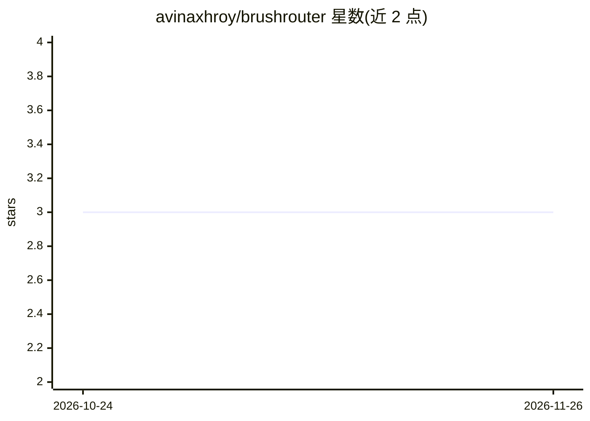

# avinaxhroy/brushrouter

⭐ 3 · JavaScript · MIT · 推送 2026-10-29 · [GitHub](https://github.com/avinaxhroy/brushrouter) · 个人维护

**复用已有订阅生成图片的路由 CLI 与 MCP 服务器**

单条命令与 MCP 服务器组成的图片生成路由器：按优先级自动把请求路由到机器上已可用的后端（ChatGPT 桌面 CLI、ChatGPT 登录、Google/Gemini CLI、OpenRouter、fal、自定义 HTTP），逐级回退。内置 164 条提示词模板（27 个任务骨架 + 137 个供应商视觉风格）供 agent 填空，所有输出经凭证脱敏器处理，模型不可见凭证。默认关闭按量计费路由；支持指定 provider、固定模型、禁用路由、透明背景与参考图。

## 筛选速览

| 维度 | 判定 | 备注 |
|---|---|---|
| AI 角色 | `ai-ecosystem` | LLM/agent 周边工具 |
| 许可风险 | `permissive` | MIT |
| 部署形态 | `library` | 以包/库形式分发 |
| 模型依赖 | locked-api |  |
| 硬件要求 | — | 无带数字的原话,不猜 |
| 安装摩擦 | `low` | 无编译、无系统依赖或容器化 |
| 成熟度 | — | 结构信号不足 |

## 能力要点

- 多后端自动路由与回退，复用已有登录，按量计费的 OpenRouter 默认关闭
- 凭证脱敏器确保模型输出中不出现 token，ChatGPT 路由走浏览器 OAuth 无需 API key
- 164 条提示词模板库，含缺失槽位报告与词法检索
- brushrouter install 可写入多种 agent 的 MCP 配置并先备份

## 适用场景

- 在终端或 MCP agent 中用已付费的订阅生成图片而不新增 API 花费
- 让 coding agent 通过 MCP 工具生成图片并填充测试过的提示词模板
- 在多个图片后端间自动回退，按需强制指定 provider 与模型

## 场景标签

`图像生成` · 领域:内容生成

## 证据(README 行号)

> L5: **Generate images with the AI you already pay for.** One CLI + MCP server that routes every request to the best imag
> L19: - **MCP-native** — `brushrouter install` wires it into any agent's image work in one command
> L135: ## Providers

## 星数曲线

2026-10-24 3 → 2026-11-26 3（+0）

---
*卡片 v1 · prompt 1.4 · 生成 2026-11-22 · 置信度 high · 依据 README sha `0900e9de3417` · [字段定义](../../DATASET.md)*
