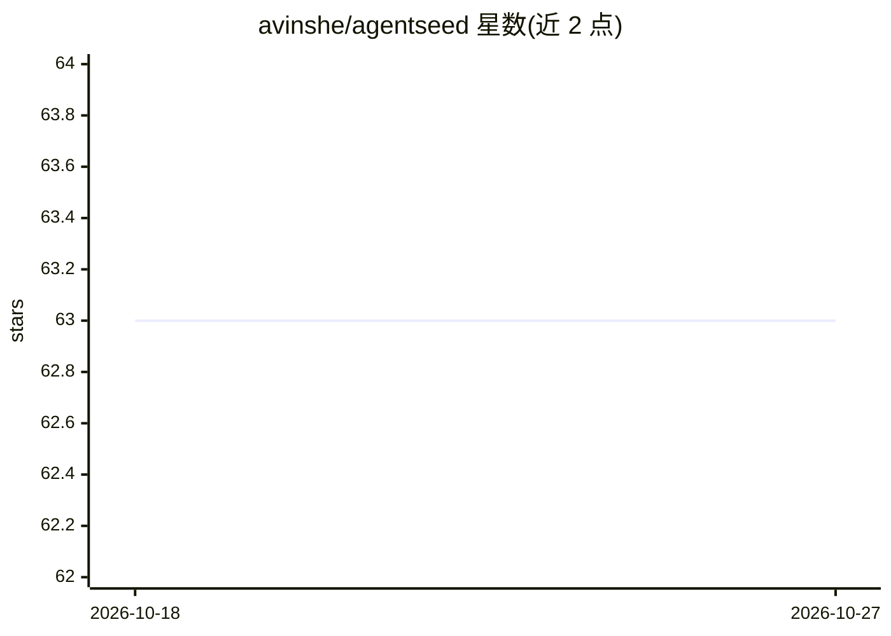

# avinshe/agentseed

⭐ 63 · TypeScript · MIT · 推送 2026-02-10 · [GitHub](https://github.com/avinshe/agentseed) · [官网](https://www.npmjs.com/package/agentseed) · 个人维护

**一条命令从代码库生成 AGENTS.md 的 CLI 工具**

面向开发者的 TypeScript CLI：通过静态分析读取代码库的语言、框架、构建/测试/lint 命令、目录结构与 monorepo 子项目，生成面向 20+ AI 编码工具的 AGENTS.md，也可按格式输出 CLAUDE.md、.cursorrules、copilot 指令等文件。静态分析路径免费、无需 API key；可选 LLM 增强路径需自带 key（Claude/GPT/Ollama），按目录调用约 $0.08。通过 git SHA 跟踪增量更新，支持 .agentseedrc 配置。

## 筛选速览

| 维度 | 判定 | 备注 |
|---|---|---|
| AI 角色 | `ai-ecosystem` | LLM/agent 周边工具 |
| 许可风险 | `permissive` | MIT |
| 部署形态 | `library` | 以包/库形式分发 |
| 模型依赖 | local-ok | 支持本地模型 |
| 硬件要求 | — | 无带数字的原话,不猜 |
| 安装摩擦 | `low` | 无编译、无系统依赖或容器化 |
| 成熟度 | — | 结构信号不足 |

## 能力要点

- 静态分析路径免费即时，无需 API key
- 可选 LLM 增强（Claude/GPT/Ollama，自带 key）
- 单命令输出 5 种格式，兼容 20+ AI 工具
- 基于 git SHA 的增量更新与 monorepo 子项目检测

## 适用场景

- 为我的仓库生成 AI 编码工具的项目说明文件
- monorepo 中按子项目生成差异化的 AGENTS.md
- 生成 Cursor、Copilot、Claude Code 等各工具专属配置

## 场景标签

`代码生成` · 领域:编码与开发

## 证据(README 行号)

> L9: One command. agentseed reads your codebase — languages, frameworks, commands, architecture, conventions — and genera
> L17: When your repo has a great AGENTS.md, every AI tool that touches your code knows your stack, respects your conventi
> L39: |`agents`|`AGENTS.md`|Copilot, Codex, Gemini, Cursor, Devin, 20+ (**default**)|

## 星数曲线

2026-10-18 63 → 2026-10-27 63（+0）

---
*卡片 v1 · prompt 1.4 · 生成 2026-10-24 · 置信度 high · 依据 README sha `950672a02376` · [字段定义](../../DATASET.md)*
