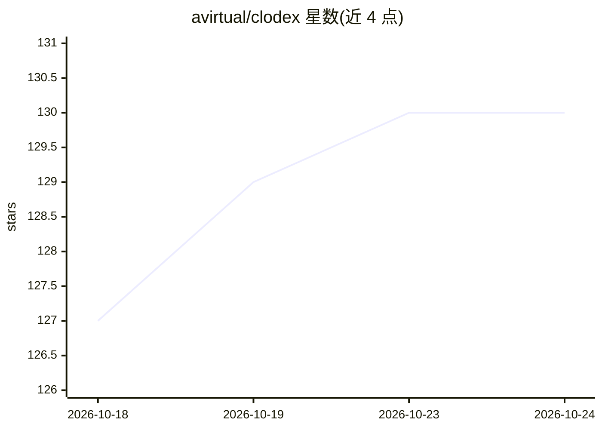

# avirtual/clodex

⭐ 132 · JavaScript · Apache-2.0 · 推送 2026-10-24 · [GitHub](https://github.com/avirtual/clodex) · [官网](https://github.com/avirtual/clodex/releases/latest) · 个人维护

**管理 Claude Code/Codex/Muse 编码代理机群的桌面与无头会话管理器**

以终端子进程方式运行 Claude Code 与 Codex CLI 会话，在会话之上提供三层：侧栏显示每个会话的活动状态、上下文填充、权限等待与消息；IPC 消息总线让代理通过 [agent:…] 文本意图互相通信、派生子代理与组建按工单/worktree 工作的团队；peer wire 将 Linux 无头节点的会话接入同一机群，clodexctl 提供类 kubectl 语法的命令行。同一引擎以 macOS 桌面应用（Electron 前端、Apple Silicon DMG）、Linux 无头节点与浏览器 GUI 三种形态运行；支持插件系统与语音听写。需自备 claude/codex CLI；部分功能仅限 Claude。

## 筛选速览

| 维度 | 判定 | 备注 |
|---|---|---|
| AI 角色 | `ai-ecosystem` | LLM/agent 周边工具 |
| 许可风险 | `permissive` | Apache-2.0 |
| 部署形态 | `desktop` | 安装包/桌面程序 |
| 模型依赖 | — | README 未给出锁定关系 |
| 硬件要求 | — | 无带数字的原话,不猜 |
| 安装摩擦 | `low` | 无编译、无系统依赖或容器化 |
| 成熟度 | — | 结构信号不足 |

## 能力要点

- 代理间通过 [agent:…] 意图协议互相通信、派生与记忆
- 跨机器 peer wire 聚合远程节点会话为同一机群
- 团队模式：角色工单、按工单 worktree、自动测试与评审门
- clodexctl 提供 kubectl 式命令行与 SSH/云/容器部署

## 适用场景

- 同时监督多个编码代理会话的状态、上下文与成本
- 让代理之间互相通信、派生子代理组成团队按工单交付
- 把 Linux 服务器的无头节点会话接入桌面侧栏统一操控

## 场景标签

`多智能体` `Agent 框架` · 领域:Agent 开发

## 证据(README 行号)

> L14: Clodex runs Claude Code and Codex sessions as terminals and adds three layers around them: a sidebar that shows the
> L53: The core is an Electron-free **engine** (sessions, messaging, persistence, the peer wire) with three frontends: the

## 星数曲线

2026-10-18 127 → 2026-10-24 130（+3）

---
*卡片 v1 · prompt 1.4 · 生成 2026-10-23 · 置信度 high · 依据 README sha `96e12665648a` · [字段定义](../../DATASET.md)*
