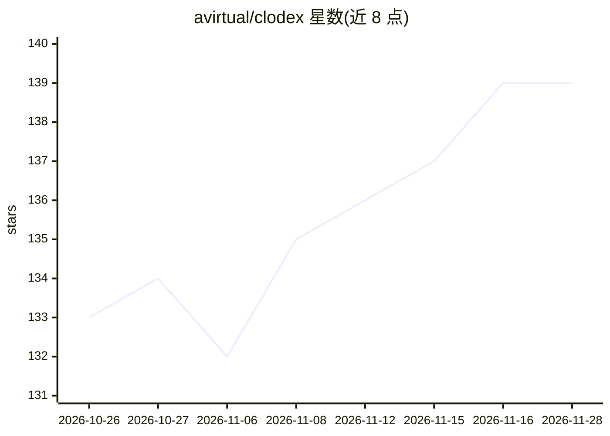

# avirtual/clodex

⭐ 139 · JavaScript · Apache-2.0 · 推送 2026-11-27 · [GitHub](https://github.com/avirtual/clodex) · [官网](https://github.com/avirtual/clodex/releases/latest) · 个人维护

**管理 Claude Code/Codex agent 舰队的会话管理器**

以终端形式运行 Claude Code 与 Codex 会话的会话管理器：侧边栏展示各会话的活动状态、上下文占用与待审批权限对话框，消息总线让 agent 之间通过文本意图互相通信（dm/spawn/memory/remind 等），peer wire 把远程 Linux 机器上的会话纳入同一舰队。引擎不依赖 Electron，同一引擎可作为 macOS 桌面应用或 Linux 无头节点运行，clodexctl 用 kubectl 风格命令驱动两者。限制：仅支持 Apple Silicon Mac（macOS 12+），Intel Mac 需从源码构建。

## 筛选速览

| 维度 | 判定 | 备注 |
|---|---|---|
| AI 角色 | `ai-ecosystem` | LLM/agent 周边工具 |
| 许可风险 | `permissive` | Apache-2.0 |
| 部署形态 | `desktop` | 安装包/桌面程序 |
| 模型依赖 | — | README 未给出锁定关系 |
| 硬件要求 | — | 无带数字的原话,不猜 |
| 安装摩擦 | `low` | 无编译、无系统依赖或容器化 |
| 成熟度 | — | 结构信号不足 |

## 能力要点

- agent 间文本意图协议：dm、spawn、memory、remind、context compact 等
- 跨机器舰队：SSH peer 后远程会话作为实时标签出现在侧边栏
- Teams 提供基于角色的工单、每工单 worktree 与自动测试-评审门
- 同一无 Electron 引擎支撑桌面应用、无头节点与浏览器 GUI 三种前端

## 适用场景

- 在一台 Mac 上集中查看并接管多台机器上的编码 agent 会话
- 让多个 Claude Code/Codex agent 通过消息总线协作完成工单
- 通过 wirescope 跟踪每轮 token、成本与缓存状态
- 在 Docker 沙箱容器中运行隔离的 agent 会话

## 场景标签

`多智能体` `编码 Agent` · 领域:Agent 开发

## 证据(README 行号)

> L14: Clodex runs Claude Code and Codex sessions as terminals and adds three layers around them: a sidebar that shows the
> L53: The core is an Electron-free **engine** (sessions, messaging, persistence, the peer wire) with three frontends: the

## 星数曲线

2026-10-26 133 → 2026-11-28 139（+6）

---
*卡片 v1 · prompt 1.4 · 生成 2026-11-27 · 置信度 high · 依据 README sha `c0d38f7f7653` · [字段定义](../../DATASET.md)*
