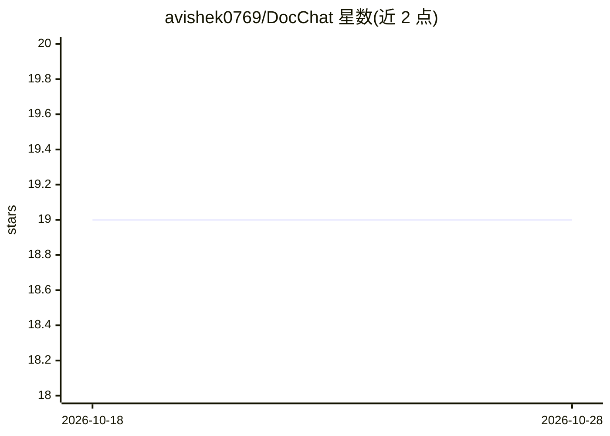

# avishek0769/DocChat

⭐ 19 · TypeScript · 推送 2026-09-05 · [GitHub](https://github.com/avishek0769/DocChat) · [官网](https://avishek.short.gy/docchat) · 个人维护

**输入文档链接即可对话问答的 RAG 应用，回答带来源**

全栈 RAG 应用：用户提供文档 URL，系统递归抓取（遵循 robots.txt）并构建可检索知识库，通过自然语言问答。React 前端 + Express 后端，BullMQ(Redis) 调度后台索引任务，向量模式经 OpenRouter 生成嵌入存入 Qdrant，元数据存 PostgreSQL；另提供无需向量的 TreeIndex 模式。支持知识库复用、可选 Mem0 长期记忆、Redis 令牌预算与审计日志、管理面板。自托管需 Node.js v20+、Docker 与 pnpm，部署流程含克隆、Docker Compose、Prisma 迁移等六步。

## 筛选速览

| 维度 | 判定 | 备注 |
|---|---|---|
| AI 角色 | `ai-native` | 本体是模型或模型工具 |
| 许可风险 | `none` | — |
| 部署形态 | `self-host` | docker 或自建部署 |
| 模型依赖 | locked-api |  |
| 硬件要求 | — | 无带数字的原话,不猜 |
| 安装摩擦 | `low` | 无编译、无系统依赖或容器化 |
| 成熟度 | — | 结构信号不足 |

## 能力要点

- 递归抓取文档站并生成可检索知识库，遵循 robots.txt
- 两种检索模式：OpenRouter+Qdrant 向量模式与无需嵌入的 TreeIndex 模式
- 知识库按 URL 复用，实现即时开聊
- 可选 Mem0 长期记忆、令牌预算限制与管理员审计面板

## 适用场景

- 把任意在线文档转成可对话的知识库并带来源提问
- 离线或资源受限环境下用 TreeIndex 模式索引文档
- 团队自托管文档问答服务并管控令牌用量

## 场景标签

`文档问答` `聊天机器人` · 领域:对话与助手

## 证据(README 行号)

> L3: Chat with any documentation using AI. Provide a documentation link, and the system will scrape, process, and convert
> L40: - **Vector Mode**: Generates vector embeddings for extracted text chunks using OpenRouter, and stores them in Qdran

## 星数曲线

2026-10-18 19 → 2026-10-28 19（+0）

---
*卡片 v1 · prompt 1.4 · 生成 2026-10-28 · 置信度 high · 依据 README sha `1ec0191f0e2b` · [字段定义](../../DATASET.md)*
