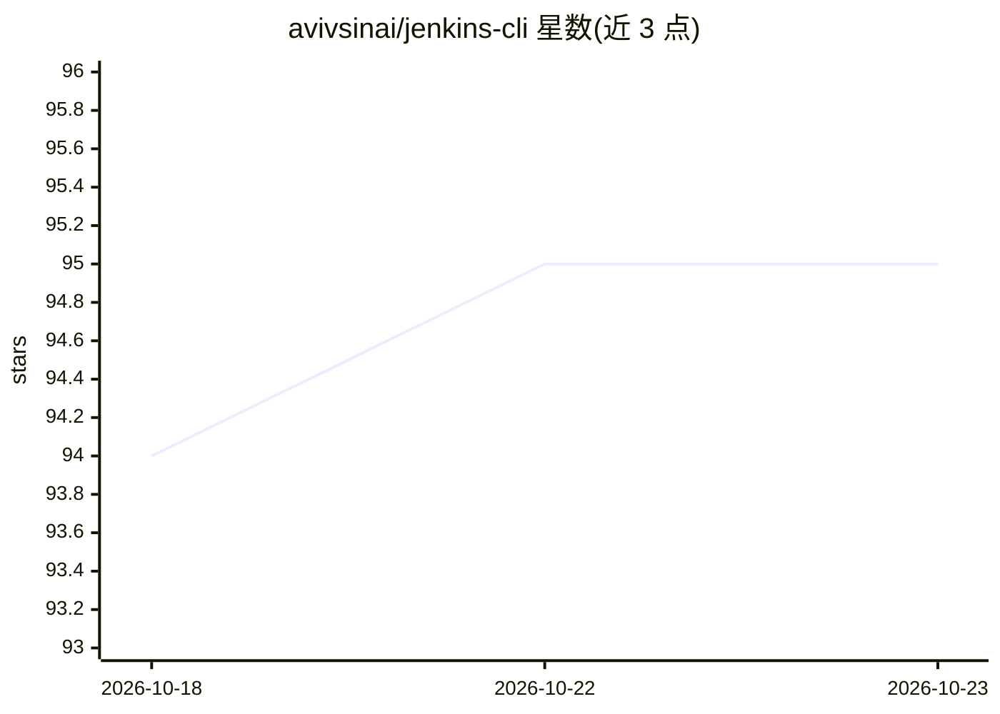

# avivsinai/jenkins-cli

⭐ 95 · Go · MIT · 推送 2026-10-22 · [GitHub](https://github.com/avivsinai/jenkins-cli) · [官网](https://github.com/avivsinai/jenkins-cli) · 个人维护

**面向 Jenkins 运维者的 GitHub CLI 风格终端工具（Go 单二进制）**

jk 是用 Go 编写的单二进制 CLI，供 Jenkins 运维者在终端中跨文件夹搜索任务、触发与跟踪运行、流式查看日志、下载产物，并管理凭据、节点、队列与插件；输出支持人类可读、JSON、YAML、jq 与 Go 模板。支持多控制器上下文切换、API token 认证（含 SSO/front door 场景）、OS keychain 存储 token。命令结构与 GitHub CLI（gh）对齐。另提供可安装到 Claude Code / Codex CLI 的 AI 编码技能（jk skill），配合面向 agent 的结构化输出与元数据。非官方 Jenkins CLI；版本保持 0.x。

## 筛选速览

| 维度 | 判定 | 备注 |
|---|---|---|
| AI 角色 | `ai-enhanced` | 去掉 AI 部分产品仍成立 |
| 许可风险 | `permissive` | MIT |
| 部署形态 | `desktop` | 安装包/桌面程序 |
| 模型依赖 | — | README 未给出锁定关系 |
| 硬件要求 | — | 无带数字的原话,不猜 |
| 安装摩擦 | `low` | 无编译、无系统依赖或容器化 |
| 成熟度 | `idea` | |

## 能力要点

- 跨文件夹搜索任务、触发/跟踪运行、流式日志、产物与测试报告
- 凭据、节点、队列与插件的平台管理命令
- JSON/YAML/jq/模板输出，附带给 agent 使用的机器可读元数据
- 可安装到 Claude Code / Codex CLI 的 AI 编码技能（npx skills / skild）

## 适用场景

- 在终端里管理多个 Jenkins 控制器并触发与排查流水线
- 脚本化/自动化 CI 流水线并消费结构化输出
- 让 Claude Code 或 Codex CLI 通过 jk 技能操作 Jenkins

## 场景标签

 · 领域:开发运维工具/CI-CD

## 证据(README 行号)

> L12: `jk` is a single Go binary for Jenkins operators. Search jobs across folders, trigger and follow runs, stream logs,
> L72: Install the `jk` skill for Claude Code or Codex CLI:

## 星数曲线

2026-10-18 94 → 2026-10-23 95（+1）

---
*卡片 v1 · prompt 1.4 · 生成 2026-10-23 · 置信度 mid · 依据 README sha `a479ee032886` · [字段定义](../../DATASET.md)*
