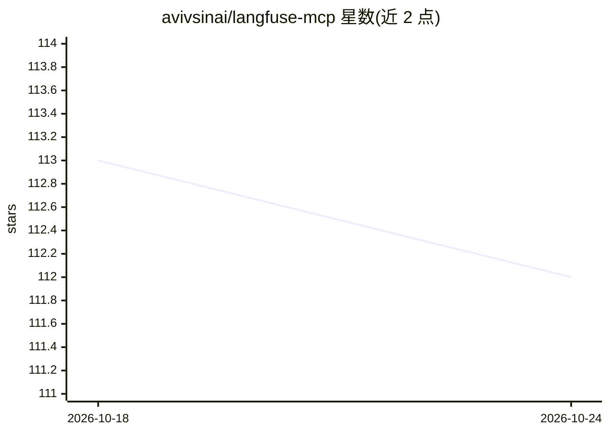

# avivsinai/langfuse-mcp

⭐ 112 · Python · MIT · 推送 2026-10-11 · [GitHub](https://github.com/avivsinai/langfuse-mcp) · [官网](https://github.com/avivsinai/langfuse-mcp) · 个人维护

**让 AI agent 查询 Langfuse 追踪数据的 MCP 服务器**

面向 Claude Code、Codex、Cursor 等 MCP 客户端的本地服务器，通过 Langfuse Python SDK 读取 trace、session、exception、prompt、dataset、指标等数据，共 48 个工具，用于 agent 调试与可观测性分析。附带第一方 langfuse agent skill 提供调试工作流。支持 stdio/HTTP 传输、工具分组按需加载、只读模式、compact/文件转储输出控制、TOML profiles 多项目凭证，及 Docker 部署（含共享 HTTP 服务器模式）。相对官方托管 MCP 的取舍：不做 score 写入、评论、媒体等 API 操作。

## 筛选速览

| 维度 | 判定 | 备注 |
|---|---|---|
| AI 角色 | `ai-ecosystem` | LLM/agent 周边工具 |
| 许可风险 | `permissive` | MIT |
| 部署形态 | `self-host` | docker 或自建部署 |
| 模型依赖 | — | README 未给出锁定关系 |
| 硬件要求 | — | 无带数字的原话,不猜 |
| 安装摩擦 | `low` | 无编译、无系统依赖或容器化 |
| 成熟度 | — | 结构信号不足 |

## 能力要点

- 48 个工具覆盖 trace/session/exception/prompt/dataset/标注队列/指标查询
- 只读模式与工具分组选择性加载以控制 token 开销
- compact/full_json_string/full_json_file 三种输出模式
- profiles.toml 多项目凭证与共享 HTTP 传输部署

## 适用场景

- 在 Claude Code/Codex/Cursor 中直接排查失败 trace 与异常分组
- 让 agent 查询推理成本与 p95 延迟等聚合指标
- 多 Langfuse 项目的凭证隔离与共享服务器部署

## 场景标签

`LLM 可观测性` · 领域:评测与运维

## 证据(README 行号)

> L12: Local MCP server and skill for Langfuse. Debug traces, sessions, and exceptions from Claude Code, Codex, Cursor, or
> L114: ## Tools (48 total)

## 星数曲线

2026-10-18 113 → 2026-10-24 112（-1）

---
*卡片 v1 · prompt 1.4 · 生成 2026-10-23 · 置信度 mid · 依据 README sha `078bca69570c` · [字段定义](../../DATASET.md)*
