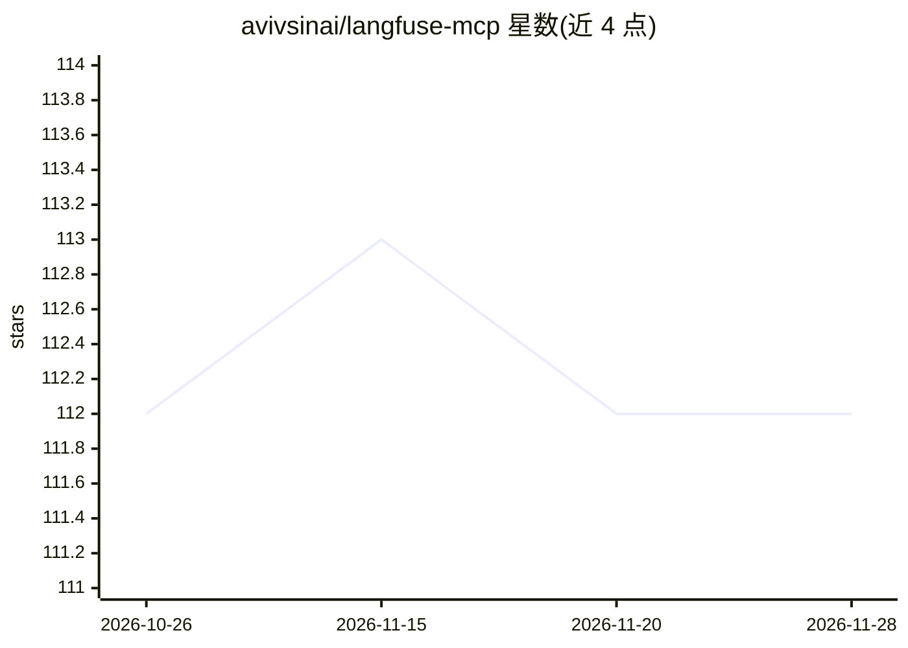

# avivsinai/langfuse-mcp

⭐ 112 · Python · MIT · 推送 2026-11-06 · [GitHub](https://github.com/avivsinai/langfuse-mcp) · [官网](https://github.com/avivsinai/langfuse-mcp) · 个人维护

**让 AI agent 查询 Langfuse 追踪数据的本地 MCP 服务器**

面向本地调试的 Langfuse MCP 服务器与技能包：为 Claude Code、Codex、Cursor 等 MCP 客户端暴露 48 个工具，覆盖追踪/观测/会话查询、异常分组定位、路由决策读取、提示词与数据集管理、标注队列及服务端指标聚合（成本/延迟/token）。提供只读模式、按工具组分加载以降低 token 开销、输出模式控制、多项目 profile 与共享 HTTP 传输。README 将其定位为本地调试用途，托管式全量 API 访问仍指向 Langfuse 官方原生 MCP。

## 筛选速览

| 维度 | 判定 | 备注 |
|---|---|---|
| AI 角色 | `ai-ecosystem` | LLM/agent 周边工具 |
| 许可风险 | `permissive` | MIT |
| 部署形态 | `self-host` | docker 或自建部署 |
| 模型依赖 | — | README 未给出锁定关系 |
| 硬件要求 | — | 无带数字的原话,不猜 |
| 安装摩擦 | `low` | 无编译、无系统依赖或容器化 |
| 成熟度 | — | 结构信号不足 |

## 能力要点

- 48 个 MCP 工具覆盖 traces/observations/sessions/exceptions/prompts/datasets/metrics 等 11 个类别
- 按工具组选择性加载与三种输出模式控制 token 开销
- --read-only 禁用全部写操作
- TOML profiles 支持多项目凭证与共享 HTTP 传输

## 适用场景

- 在 Claude Code 中用自然语言定位最近一天的错误追踪
- 按文件分组排查 LLM 应用异常并查看完整堆栈
- 用指标查询回答推理成本与 p95 延迟问题
- 同一机器管理多个 Langfuse 项目的 MCP 接入

## 场景标签

`LLM 可观测性` · 领域:评测与运维

## 证据(README 行号)

> L12: Local MCP server and skill for Langfuse. Debug traces, sessions, and exceptions from Claude Code, Codex, Cursor, or
> L114: ## Tools (48 total)
> L144: `query_metrics` aggregates telemetry server-side (cost, latency, tokens, counts, score values) so agents can answe

## 星数曲线

2026-10-26 112 → 2026-11-28 112（+0）

---
*卡片 v1 · prompt 1.4 · 生成 2026-11-28 · 置信度 high · 依据 README sha `e1e25bf54f36` · [字段定义](../../DATASET.md)*
