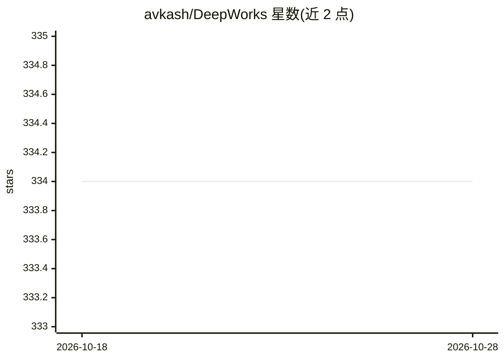

# avkash/DeepWorks

⭐ 334 · Jupyter Notebook · 推送 2026-10-10 · [GitHub](https://github.com/avkash/DeepWorks) · [官网](https://youtube.com/@prodramp) · 个人维护

**深度学习项目与教程资源合集，配 YouTube 视频讲解**

由 Avkash Chauhan（Prodramp）维护的深度学习项目与资源聚合仓库，条目按主题组织：开发者教程（Python 数据处理、Gradio、打包发布）、LLM 与开源模型、NeRF、生成式 AI、深度学习内容（Whisper、Stable Diffusion、JoJoGAN、VQ-GAN 等）及开发者工具（CUDA/JAX/dlib 安装指南、Apple M1 GPU）。多数条目关联作者 YouTube 频道的对应视频系列。仓库为清单形态，不提供可安装的软件本体。

## 筛选速览

| 维度 | 判定 | 备注 |
|---|---|---|
| AI 角色 | `ai-knowledge` | 知识聚合/清单类 |
| 许可风险 | `none` | — |
| 部署形态 | `None` |  |
| 模型依赖 | — | README 未给出锁定关系 |
| 硬件要求 | — | 无带数字的原话,不猜 |
| 安装摩擦 | `medium` | 含编译或系统依赖之一 |
| 成熟度 | — | 结构信号不足 |

## 能力要点

- 按主题分类聚合深度学习项目、模型与研究资源
- 开发者工具部分收录 CUDA/JAX/dlib/M1 GPU 环境安装指南
- 多数条目对应 Prodramp YouTube 频道视频系列

## 适用场景

- 查找深度学习、NeRF、生成式 AI 的学习项目与教程
- 跟随视频系列学习模型训练、推理与部署
- 查阅深度学习 GPU 环境配置指南

## 场景标签

`教程课程` `精选清单` · 领域:学习与行业

## 证据(README 行号)

> L4: A collection of Deep Learning projects and resources
> L6: Join my @Prodramp YouTube Channel for all things about Data Science, machine learning and Artificial Intelligence an

## 星数曲线

2026-10-18 334 → 2026-10-28 334（+0）

---
*卡片 v1 · prompt 1.4 · 生成 2026-10-21 · 置信度 high · 依据 README sha `db58b47a3c4c` · [字段定义](../../DATASET.md)*
