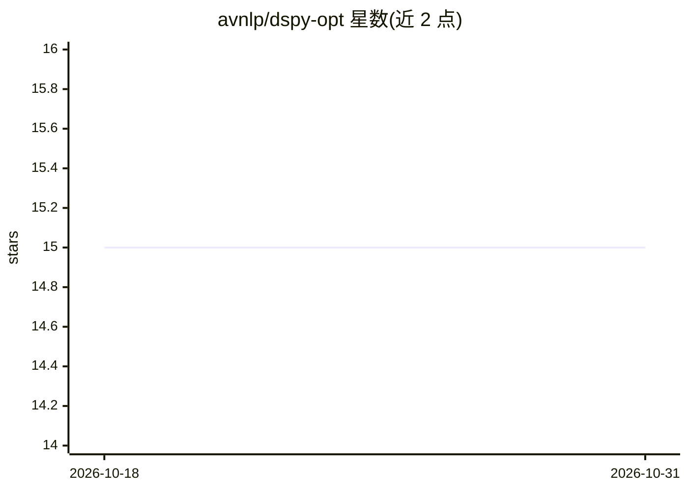

# avnlp/dspy-opt

⭐ 15 · Python · MIT · 推送 2026-10-06 · [GitHub](https://github.com/avnlp/dspy-opt) · 组织维护

**基于 DSPy 的 RAG 流水线自动优化框架**

在 DSPy 框架上实现多阶段 RAG 流水线（查询改写、子查询分解、元数据抽取、Weaviate 混合检索），并使用 MIPROv2、COPRO、BootstrapFewShot、SIMBA、GEPA 五种优化器，以 DeepEval 指标（相关性、忠实度、上下文精确率/召回率等）为评价目标自动调优提示词与 few-shot 示例。覆盖 FreshQA、HotpotQA、PubMedQA、TriviaQA、Wikipedia 五个 QA 数据集，YAML 驱动配置，Confident AI 记录评测日志。通过 uv 管理依赖，需配置 Weaviate 与 Groq 的 API key。

## 筛选速览

| 维度 | 判定 | 备注 |
|---|---|---|
| AI 角色 | `ai-ecosystem` | LLM/agent 周边工具 |
| 许可风险 | `permissive` | MIT |
| 部署形态 | `library` | 以包/库形式分发 |
| 模型依赖 | — | README 未给出锁定关系 |
| 硬件要求 | — | 无带数字的原话,不猜 |
| 安装摩擦 | `low` | 无编译、无系统依赖或容器化 |
| 成熟度 | — | 结构信号不足 |

## 能力要点

- 多阶段 RAG 流水线：查询改写→子查询分解→元数据抽取→Weaviate 混合检索
- 5 种 DSPy 优化器（MIPROv2/COPRO/BootstrapFewShot/SIMBA/GEPA）自动调优提示词与示例
- DeepEval 五项指标驱动优化，GEPA 路径附带文本反馈供反思 LLM 使用
- 5 个 QA 数据集（单跳/多跳/生物医学/百科）与 YAML 配置

## 适用场景

- 自动调优 RAG 提示词与 few-shot 示例选择
- 对比不同 DSPy 优化器在多个 QA 数据集上的效果
- 构建带查询改写与子查询分解的检索问答流水线

## 场景标签

`RAG` `提示工程` · 领域:Agent 开发

## 证据(README 行号)

> L12: This repository implements several Retrieval-Augmented Generation (RAG) pipelines on diverse question answering dat
> L16: - **DSPy** for modular pipeline design and optimization.
> L60: - **Optimization**: DSPy optimizers automatically tune prompts and select few-shot examples by exploring the space 

## 星数曲线

2026-10-18 15 → 2026-10-31 15（+0）

---
*卡片 v1 · prompt 1.4 · 生成 2026-10-30 · 置信度 high · 依据 README sha `c71032774c11` · [字段定义](../../DATASET.md)*
