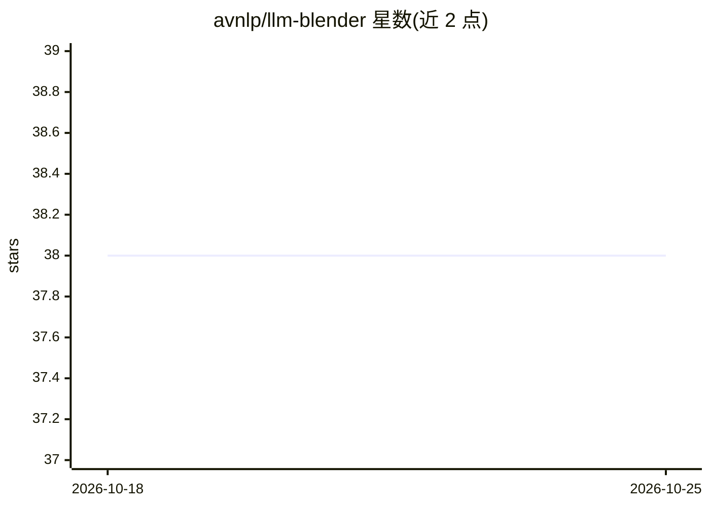

# avnlp/llm-blender

⭐ 38 · Python · MIT · 推送 2026-07-22 · [GitHub](https://github.com/avnlp/llm-blender) · 组织维护

**将 LLM-Blender 集成进 Haystack RAG 管道的多模型集成工具**

基于 LLM-Blender 框架构建的项目，实现自定义 Haystack 组件 LLMBlenderRanker，把多 LLM 输出的两两比较排序（PairRanker）与 Top-K 融合生成（GenFuser）接入 RAG 管道。在 BillSum 与 MixInstruct 数据集上以 BERTScore/BARTScore/BLEURT 评估了 Llama-3-8B、Phi-3-mini、Mistral-7B 等模型的集成效果。通过 git clone 源码运行，因 llm-blender 库无稳定版本，相关代码已内嵌到项目中。

## 筛选速览

| 维度 | 判定 | 备注 |
|---|---|---|
| AI 角色 | `ai-ecosystem` | LLM/agent 周边工具 |
| 许可风险 | `permissive` | MIT |
| 部署形态 | `None` |  |
| 模型依赖 | — | README 未给出锁定关系 |
| 硬件要求 | — | 无带数字的原话,不猜 |
| 安装摩擦 | `low` | 无编译、无系统依赖或容器化 |
| 成熟度 | — | 结构信号不足 |

## 能力要点

- PairRanker 用两两比较（cross-attention 编码器）对多 LLM 候选输出排序
- GenFuser 以 seq2seq 方式融合 Top-K 候选生成最终输出
- 自定义 LLMBlenderRanker 组件接入 Haystack RAG 管道
- 在 BillSum/MixInstruct 数据集上以三种指标评估多模型集成结果

## 适用场景

- 在 RAG 问答管道中集成多个 LLM 的输出以提升回答质量
- 复现或扩展 LLM-Blender 在新模型上的集成实验
- 对多模型生成结果做排序与融合的评估研究

## 场景标签

`RAG` · 领域:知识与检索

## 证据(README 行号)

> L7: - LLM-Blender is a two-stage ensemble learning framework. In the first stage (ranking), pairwise comparison of candi
> L11: - A custom Haystack component, `LLMBlenderRanker`, has been implemented to integrate LLM-Blender with Haystack pipe
> L39: To run the pipelines, you will need to clone this repository and install the required libraries.

## 星数曲线

2026-10-18 38 → 2026-10-25 38（+0）

---
*卡片 v1 · prompt 1.4 · 生成 2026-10-25 · 置信度 high · 依据 README sha `a6de8036a327` · [字段定义](../../DATASET.md)*
