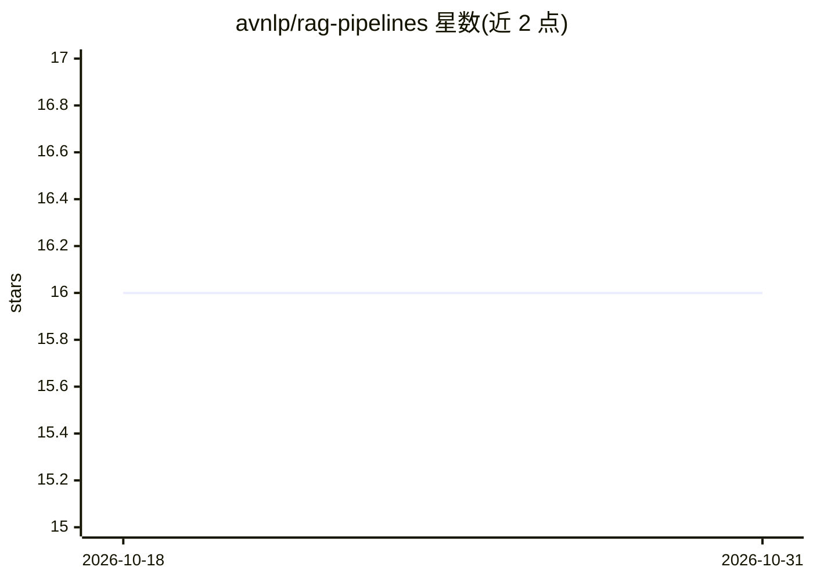

# avnlp/rag-pipelines

⭐ 16 · Python · MIT · 推送 2026-10-06 · [GitHub](https://github.com/avnlp/rag-pipelines) · 组织维护

**面向医疗与金融问答的 RAG 管道框架：检索、生成与评测一体**

覆盖六个领域数据集（HealthBench、MedCaseReasoning、MetaMedQA、PubMedQA、FinanceBench、Earnings Calls）的 RAG 管道项目。索引阶段用 Unstructured 切块并做三层元数据增强后存入 Milvus（稠密+BM25 混合检索，RRF 融合）；评测阶段由 LangGraph 编排：查询元数据提取生成过滤表达式、混合检索、Contextual AI 指令跟随重排器、BAML 定义的结构化生成（Groq/Cerebras/SambaNova 三级故障切换）、DeepEval 指标评测。通过 YAML 配置各管道，用 uv 管理依赖，需配置 Groq、Milvus、Unstructured API key。

## 筛选速览

| 维度 | 判定 | 备注 |
|---|---|---|
| AI 角色 | `ai-ecosystem` | LLM/agent 周边工具 |
| 许可风险 | `permissive` | MIT |
| 部署形态 | `library` | 以包/库形式分发 |
| 模型依赖 | locked-api |  |
| 硬件要求 | — | 无带数字的原话,不猜 |
| 安装摩擦 | `low` | 无编译、无系统依赖或容器化 |
| 成熟度 | — | 结构信号不足 |

## 能力要点

- Milvus 稠密+BM25 混合检索并以 RRF 融合
- 三层元数据增强（规则/用户定义 LLM 字段/RAG 优化字段）与多级缓存
- BAML 结构化生成，三 LLM 提供商自动故障切换
- Contextual AI 指令跟随重排器，自动 GPU 检测

## 适用场景

- 在医疗基准数据集上搭建并评测 RAG 问答管道
- 处理财报与财报电话会议等金融文档问答
- 按领域自定义元数据 schema 与检索过滤条件

## 场景标签

`RAG` `模型评测` · 领域:评测与运维

## 证据(README 行号)

> L16: - **LangGraph** for async workflow orchestration.
> L62: - **Evaluation**: Scores the generated response against ground truth using a suite of metrics including contextual 

## 星数曲线

2026-10-18 16 → 2026-10-31 16（+0）

---
*卡片 v1 · prompt 1.4 · 生成 2026-10-30 · 置信度 high · 依据 README sha `854da5e1a83e` · [字段定义](../../DATASET.md)*
