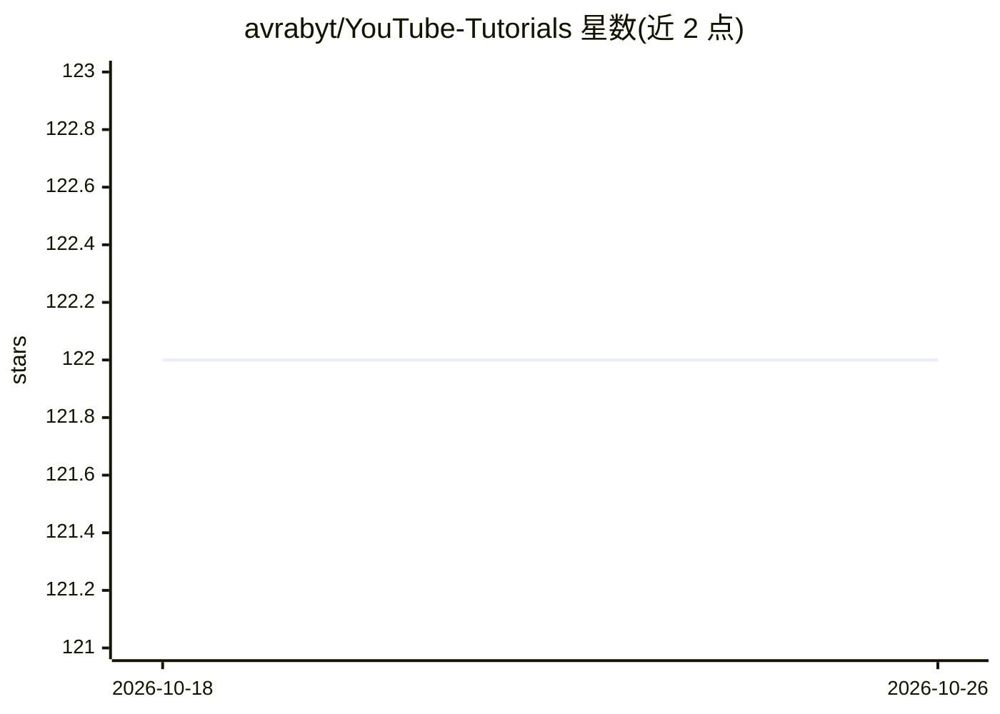

# avrabyt/YouTube-Tutorials

⭐ 122 · Python · MIT · 推送 2026-10-24 · [GitHub](https://github.com/avrabyt/YouTube-Tutorials) · [官网](https://www.youtube.com/c/Avra_b) · 个人维护

**YouTube 教程视频合集仓库：Python/ML/bioinformatics/OpenAI 主题**

个人内容创作者维护的视频教程集合仓库，按 Streamlit、机器学习、AI/chatGPT、Python 自动化、生物信息学、OpenAI Web 应用等播放列表组织，README 提供播放列表链接、最新视频标题与博客文章列表及周报订阅链接。仓库本体不含可安装的代码或工具，主要作为频道内容的导航入口，主题标签还包含 Google Sheets、Pandas 等数据处理话题。

## 筛选速览

| 维度 | 判定 | 备注 |
|---|---|---|
| AI 角色 | `ai-knowledge` | 知识聚合/清单类 |
| 许可风险 | `permissive` | MIT |
| 部署形态 | `None` |  |
| 模型依赖 | — | README 未给出锁定关系 |
| 硬件要求 | — | 无带数字的原话,不猜 |
| 安装摩擦 | `low` | 无编译、无系统依赖或容器化 |
| 成熟度 | — | 结构信号不足 |

## 能力要点

- 按 6 个主题播放列表组织教程视频
- 覆盖 Python、Streamlit、机器学习、生物信息学、OpenAI API
- 附博客文章列表与每周 AI newsletter 订阅链接

## 适用场景

- 查找 Python 与机器学习入门视频教程
- 学习用 Streamlit 与 OpenAI API 搭建 Web 应用
- 查找生物信息学方向的 Python 教程

## 场景标签

`教程课程` · 领域:学习与行业

## 证据(README 行号)

> L7: **Topics overview :** `Python` `Streamlit` `Machine-Learning` `openAI` `Google-sheets` `Automation` `Pandas` `Bioinf
> L16: ### 📺 Latest YouTube Videos

## 星数曲线

2026-10-18 122 → 2026-10-26 122（+0）

---
*卡片 v1 · prompt 1.4 · 生成 2026-10-23 · 置信度 high · 依据 README sha `804b5ad1a61e` · [字段定义](../../DATASET.md)*
