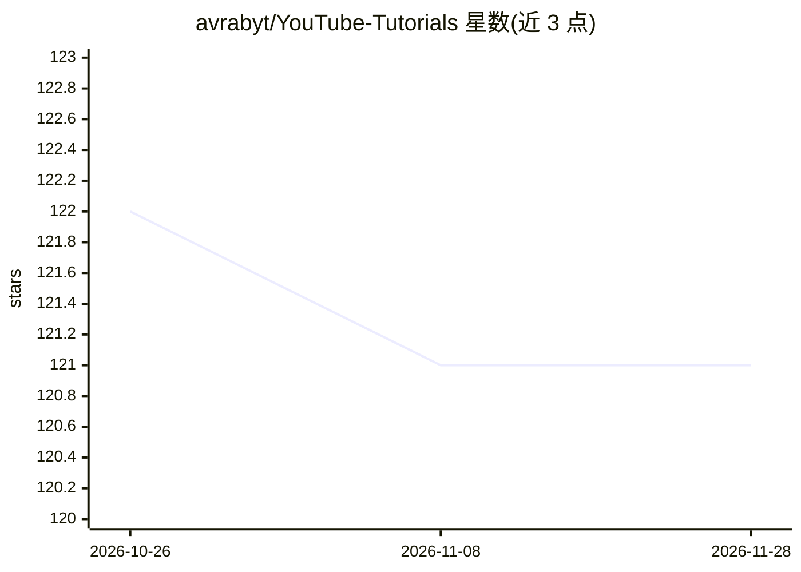

# avrabyt/YouTube-Tutorials

⭐ 121 · Python · MIT · 推送 2026-10-27 · [GitHub](https://github.com/avrabyt/YouTube-Tutorials) · [官网](https://www.youtube.com/c/Avra_b) · 个人维护

**面向学习者的 YouTube 教程视频目录集合（Python/ML/AI 等）**

该仓库是作者多年 YouTube 教程视频的索引目录，按五个播放列表组织：Streamlit-Python、Machine-Learning for all、AI/chatGPT、Python-Automation、Bioinformatics with Python，另含 openAI/chatGPT Web Apps 专题。页面同时列出频道最新视频、订阅与观看数据、博客文章链接及每周 AI Newsletter 订阅入口。仓库本身不包含可安装运行的软件，定位为教学内容与文章的导航清单。

## 筛选速览

| 维度 | 判定 | 备注 |
|---|---|---|
| AI 角色 | `ai-knowledge` | 知识聚合/清单类 |
| 许可风险 | `permissive` | MIT |
| 部署形态 | `None` |  |
| 模型依赖 | — | README 未给出锁定关系 |
| 硬件要求 | — | 无带数字的原话,不猜 |
| 安装摩擦 | `low` | 无编译、无系统依赖或容器化 |
| 成熟度 | — | 结构信号不足 |

## 能力要点

- 按 5 个主题播放列表组织教程：Streamlit、机器学习、chatGPT、自动化、生物信息学
- 列出频道最新视频与订阅/观看数据
- 附带博客文章与每周 AI Newsletter 订阅链接

## 适用场景

- 查找 Python、Streamlit、机器学习的视频教程
- 了解 chatGPT/openAI 应用开发的入门示例
- 订阅作者的 AI 技术周报与博客

## 场景标签

`教程课程` `精选清单` · 领域:学习与行业

## 证据(README 行号)

> L3: Streamlit Playlist
> L9: 1. Streamlit-Python
> L11: 3. AI /chatGPT etc

## 星数曲线

2026-10-26 122 → 2026-11-28 121（-1）

---
*卡片 v1 · prompt 1.4 · 生成 2026-11-28 · 置信度 high · 依据 README sha `bd9f20f8adf4` · [字段定义](../../DATASET.md)*
