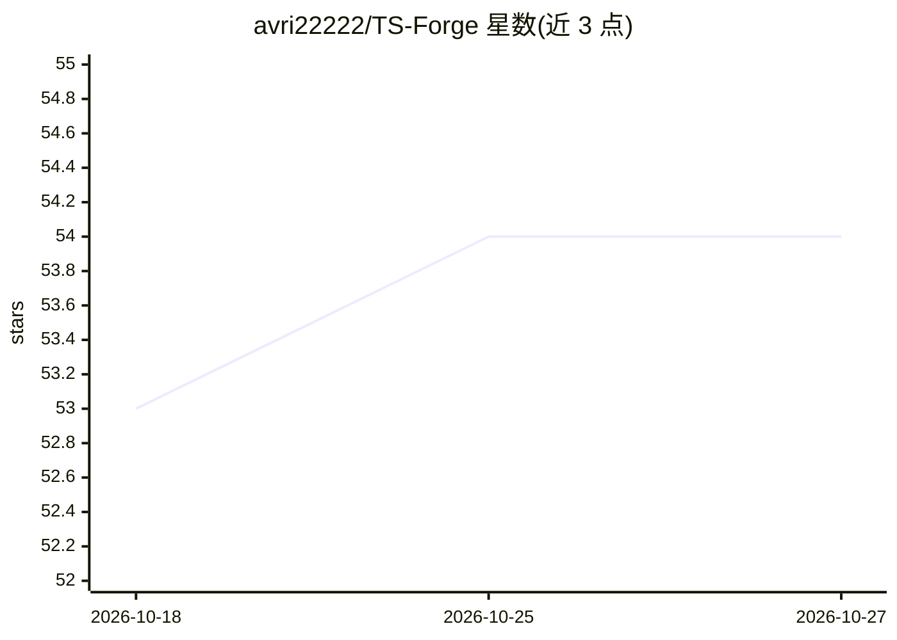

# avri22222/TS-Forge

⭐ 54 · HTML · 推送 2026-10-26 · [GitHub](https://github.com/avri22222/TS-Forge) · 组织维护

**自称开源 AI 训练程序：数据集、微调配方与可复现流水线集合**

README 自述为一个 Apache 2.0 许可（正文又声明 MIT，两处许可声明不一致）的社区驱动 AI 训练项目，声称提供模块化训练流水线、可复现实验追踪（每次运行生成 manifest）、数据集来源台账、分布式算力编排、评测套件、插件注册表、多语言界面与自适应仪表盘。架构分四层（Bedrock/Kiln/Lens/Canopy）。README 未给出任何安装或运行命令，也未链接到具体代码路径；含 2026 路线图与治理、安全声明。面向贡献者、研究者和机构，具体可运行性无法从 README 验证。

## 筛选速览

| 维度 | 判定 | 备注 |
|---|---|---|
| AI 角色 | `ai-ecosystem` | LLM/agent 周边工具 |
| 许可风险 | `none` | — |
| 部署形态 | `None` |  |
| 模型依赖 | — | README 未给出锁定关系 |
| 硬件要求 | — | 无带数字的原话,不猜 |
| 安装摩擦 | `low` | 无编译、无系统依赖或容器化 |
| 成熟度 | — | 结构信号不足 |

## 能力要点

- 自述提供模块化训练流水线与每次运行生成 manifest 的可复现实验追踪
- 自述数据集切片携带来源、许可与预处理历史
- 自述支持从单工作站到异构集群的分布式编排
- 自述插件注册表可插入自定义回调与指标

## 适用场景

- 查看并参与社区维护的 AI 训练流水线与数据集
- 追踪可复现的模型训练实验
- 在异构算力环境运行评测套件

## 场景标签

`模型训练` `微调` `模型评测` · 领域:评测与运维

## 证据(README 行号)

> L16: TS-Source began as a modest experiment: a small collective of engineers who believed that training data, model weig
> L37: - **Modular Training Pipelines** — Swap tokenizers, optimizers, and schedulers without rewriting the entire stack.

## 星数曲线

2026-10-18 53 → 2026-10-27 54（+1）

---
*卡片 v1 · prompt 1.4 · 生成 2026-10-24 · 置信度 low · 依据 README sha `5ce0f9985fc2` · [字段定义](../../DATASET.md)*
