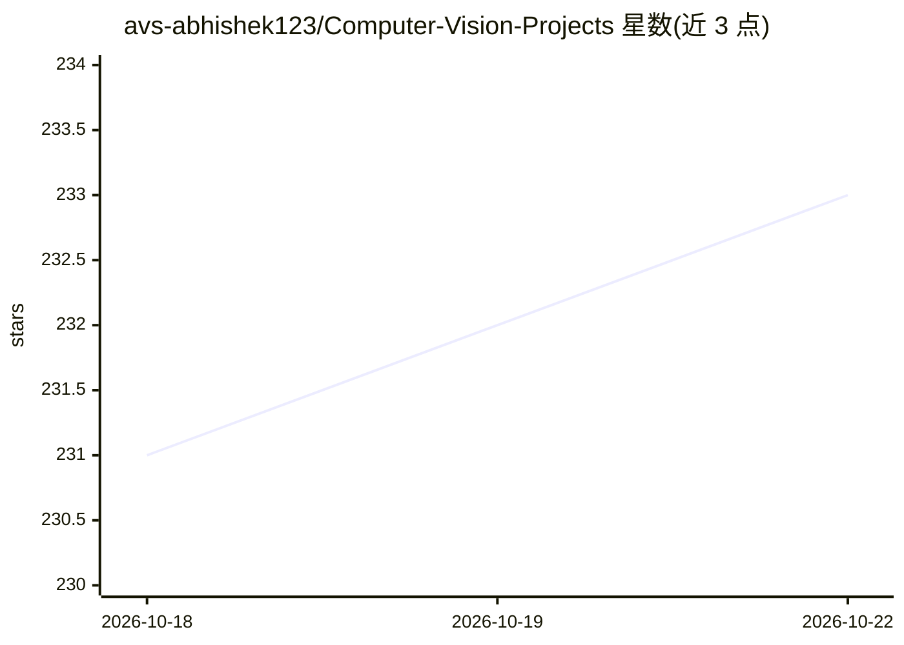

# avs-abhishek123/Computer-Vision-Projects

⭐ 233 · Jupyter Notebook · 推送 2026-05-02 · [GitHub](https://github.com/avs-abhishek123/Computer-Vision-Projects) · 个人维护

**计算机视觉项目合集仓库（初学者到进阶）**

一个聚合计算机视觉项目的 GitHub 仓库，主题标签覆盖深度学习、目标检测、目标识别、目标跟踪，并标注 OpenCV、Pillow、Python3 等技术。README 内容极少，仅包含标题、Star History 图表与开发中声明，未说明各项目内容、安装方式或运行方法。仓库维护者以个人身份维护，通过求 Star 方式征集支持。项目具体完成度与可用性无法从 README 验证。

## 筛选速览

| 维度 | 判定 | 备注 |
|---|---|---|
| AI 角色 | `ai-knowledge` | 知识聚合/清单类 |
| 许可风险 | `none` | — |
| 部署形态 | `None` |  |
| 模型依赖 | — | README 未给出锁定关系 |
| 硬件要求 | — | 无带数字的原话,不猜 |
| 安装摩擦 | `low` | 无编译、无系统依赖或容器化 |
| 成熟度 | `idea` | |

## 能力要点

- 主题标签涵盖目标检测、识别与跟踪
- 技术栈标注 OpenCV、Pillow、Python3
- 自述为进行中（Work in progress）

## 适用场景

- 浏览计算机视觉项目示例寻找参考实现
- 初学者按主题查找深度学习视觉项目

## 场景标签

 · 领域:计算机视觉

## 证据(README 行号)

> L1: # Computer Vision Projects

## 星数曲线

2026-10-18 231 → 2026-10-22 233（+2）

---
*卡片 v1 · prompt 1.4 · 生成 2026-10-22 · 置信度 low · 依据 README sha `c90c7ad37198` · [字段定义](../../DATASET.md)*
