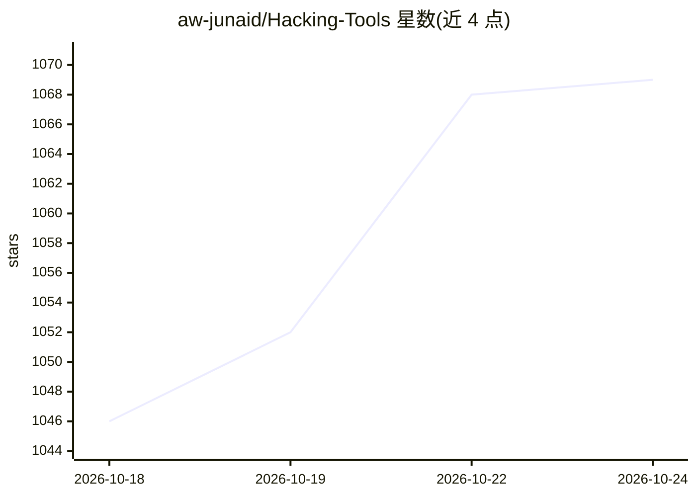

# aw-junaid/Hacking-Tools

⭐ 1,069 · C · NOASSERTION · 推送 2026-08-19 · [GitHub](https://github.com/aw-junaid/Hacking-Tools) · [官网](https://awjunaid.com) · 个人维护

**道德黑客工具与恶意软件样本的聚合参考清单**

由 awjunaid 维护的安全研究与渗透测试资源聚合仓库：分类收录 Android 恶意软件样本与家族、汇编语言学习条目、C 语言漏洞利用代码、对称/非对称加密算法说明等，覆盖 Python/Rust/Go/C++ 等多种语言编写的工具。仓库声明仅供授权安全研究、恶意软件分析与教育用途，要求在隔离实验环境中使用。README 主体为分类条目清单与链接，无统一安装或运行流程。

## 筛选速览

| 维度 | 判定 | 备注 |
|---|---|---|
| AI 角色 | `ai-knowledge` | 知识聚合/清单类 |
| 许可风险 | `none` | NOASSERTION |
| 部署形态 | `desktop` | 安装包/桌面程序 |
| 模型依赖 | — | README 未给出锁定关系 |
| 硬件要求 | — | 无带数字的原话,不猜 |
| 安装摩擦 | `medium` | 含编译或系统依赖之一 |
| 成熟度 | — | 结构信号不足 |

## 能力要点

- 按 Android 恶意软件、汇编、C 漏洞利用、密码学等类别组织条目
- 收录 40+ 个 Android 恶意软件家族与样本的参考条目
- 包含对称/非对称/变换加密算法的条目说明

## 适用场景

- 安全研究人员查找恶意软件样本与家族参考
- 学习汇编语言与漏洞利用相关概念
- 渗透测试人员浏览分类的安全工具资源

## 场景标签

`网络安全` `精选清单` · 领域:学习与行业

## 证据(README 行号)

> L55: **Android Malware Samples & Families** — Reference collection of Android malware, spyware, and trojan samples for r
> L97: ## Assembly Language
> L172: ## C Hacking Tools
> L184: ## Cryptography

## 星数曲线

2026-10-18 1,046 → 2026-10-24 1,069（+23）

---
*卡片 v1 · prompt 1.4 · 生成 2026-10-21 · 置信度 low · 依据 README sha `8f841e7798a0` · [字段定义](../../DATASET.md)*
