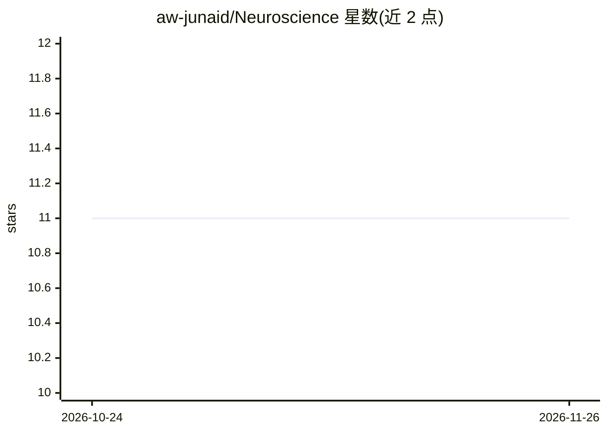

# aw-junaid/Neuroscience

⭐ 11 · GPL-3.0 · 推送 2026-04-16 · [GitHub](https://github.com/aw-junaid/Neuroscience) · [官网](https://awjunaid.com) · 个人维护

**计算神经科学资源清单：工具库、教材、课程与实验室**

一份计算神经科学领域的资源汇总清单：按语言（Python/Matlab/C++/JavaScript/R）整理神经数据分析与脑模拟工具库，收录开放教材、博客、MOOC、数据集与社区渠道，并列出欧洲与北美的计算神经科学研究实验室及 PI 研究方向与申请入口。README 本身不提供可安装的软件，属于面向学习与科研选型的目录型内容。

## 筛选速览

| 维度 | 判定 | 备注 |
|---|---|---|
| AI 角色 | `ai-knowledge` | 知识聚合/清单类 |
| 许可风险 | `viral` | GPL-3.0 |
| 部署形态 | `None` |  |
| 模型依赖 | — | README 未给出锁定关系 |
| 硬件要求 | — | 无带数字的原话,不猜 |
| 安装摩擦 | `low` | 无编译、无系统依赖或容器化 |
| 成熟度 | — | 结构信号不足 |

## 能力要点

- 按语言分类的神经科学工具库清单（Nengo、Brian2、MNE-Python 等）
- 收录开放教材、MOOC 与数据集等学习资源
- 按地区列出计算神经科学研究实验室与 PI 研究方向

## 适用场景

- 查找处理 EEG/fMRI 等神经数据的分析工具
- 选择计算神经科学方向的在线课程与教材
- 了解海外计算神经科学实验室的申请途径

## 场景标签

`精选清单` `科研工具` · 领域:学习与行业

## 证据(README 行号)

> L3: > Explore neuroscience concepts: brain modeling, neural networks, and cognitive simulations. Includes datasets, tool
> L41: ### Python
> L127: ## Computational Neuroscience Research Labs

## 星数曲线

2026-10-24 11 → 2026-11-26 11（+0）

---
*卡片 v1 · prompt 1.4 · 生成 2026-11-18 · 置信度 high · 依据 README sha `b8558c31a7d2` · [字段定义](../../DATASET.md)*
