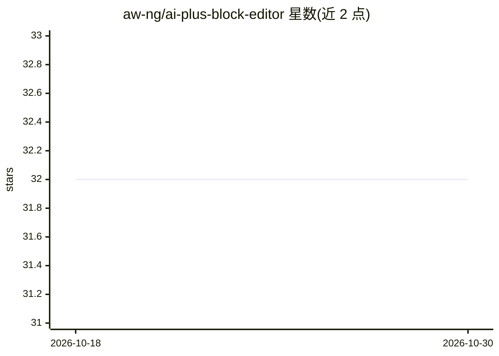

# aw-ng/ai-plus-block-editor

⭐ 32 · PHP · GPL-3.0 · 推送 2026-06-16 · [GitHub](https://github.com/aw-ng/ai-plus-block-editor) · [官网](https://wordpress.org/plugins/ai-plus-block-editor/) · 组织维护

**为 WordPress 区块编辑器添加 AI 内容生成的插件**

WordPress 插件，在 Gutenberg 区块编辑器内提供标题、摘要、Slug、SEO 关键词的 AI 生成功能，面向博主、编辑等内容创作者。用户需自备 AI 提供商（如 OpenAI）的 API key，并在插件选项页保存。内置针对 Claude、DeepSeek、Gemini、Grok、OpenAI 的 PHP 过滤器钩子（endpoint、args、system prompt 等可自定义），并提供 REST 路由、表单字段等扩展钩子。从 WordPress 插件仓库或 release 标签下载安装。

## 筛选速览

| 维度 | 判定 | 备注 |
|---|---|---|
| AI 角色 | `ai-native` | 本体是模型或模型工具 |
| 许可风险 | `viral` | GPL-3.0 |
| 部署形态 | `None` |  |
| 模型依赖 | locked-api |  |
| 硬件要求 | — | 无带数字的原话,不猜 |
| 安装摩擦 | `low` | 无编译、无系统依赖或容器化 |
| 成熟度 | — | 结构信号不足 |

## 能力要点

- 在区块编辑器内生成标题、摘要、Slug、SEO 关键词
- 支持 Claude/DeepSeek/Gemini/Grok/OpenAI 等多家提供商并可切换
- 提供 PHP 钩子自定义 AI 提供商、endpoint、参数与系统提示词
- 提供 JS 钩子（如 allowedBlocks）扩展编辑器集成

## 适用场景

- 写文章时直接在编辑器里生成摘要与 SEO 关键词
- 为文章快速生成多个标题候选与 Slug
- 通过钩子接入自选的 LLM 提供商并定制提示词

## 场景标签

`AI 写作` · 领域:内容生成

## 证据(README 行号)

> L2: Add AI Capabilities to the WP Block Editor.
> L16: Generate __Captions/Headlines__, __Summaries__, __Slugs__, __SEO Keywords__ using our amazing plugin. It is fast an
> L32: To get started, you would need to have an API key of your own provided by AI Provider for e.g. Open AI. Head over t

## 星数曲线

2026-10-18 32 → 2026-10-30 32（+0）

---
*卡片 v1 · prompt 1.4 · 生成 2026-10-26 · 置信度 high · 依据 README sha `c13cadfed483` · [字段定义](../../DATASET.md)*
