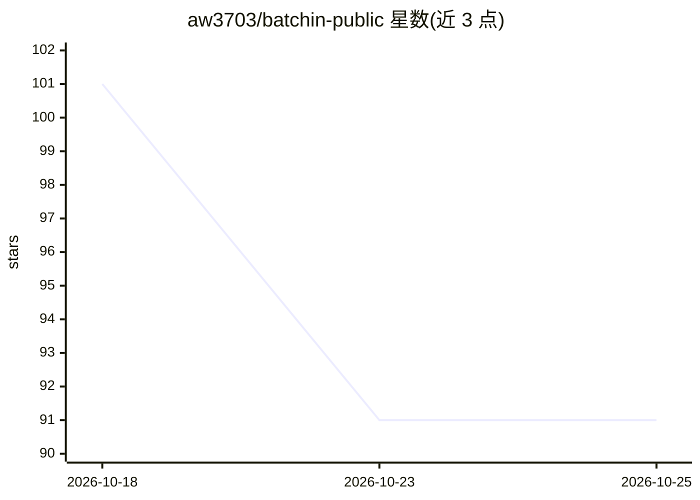

# aw3703/batchin-public

⭐ 91 · Python · Apache-2.0 · 推送 2026-10-12 · [GitHub](https://github.com/aw3703/batchin-public) · [官网](https://batchin.tech) · 个人维护 · 中文 README

**BatchIn 推理网关的客户端开发资源：SDK/CLI/MCP 连接器与凭证核验**

面向开发者的托管推理 API 客户端集合，含 TypeScript 与 Python SDK、Vercel AI SDK 适配器、MCP 服务器、CLI 及 VaaS 凭证核验客户端，另含公开的 VaaS 合约接口。托管 API 为唯一事实来源，模型仅在账户获授权且 API 目录报告已验证的供应商、定价与账单证据时可用；SDK 如实暴露供应商错误与不可用状态。链上锚定、x402/USDC 支付路径按账户与环境门控。本地开发需 Node 20+ 或 Python 3.10+，测试用固定夹具与模拟传输，无需凭证。

## 筛选速览

| 维度 | 判定 | 备注 |
|---|---|---|
| AI 角色 | `ai-ecosystem` | LLM/agent 周边工具 |
| 许可风险 | `permissive` | Apache-2.0 |
| 部署形态 | `library` | 以包/库形式分发 |
| 模型依赖 | — | README 未给出锁定关系 |
| 硬件要求 | — | 无带数字的原话,不猜 |
| 安装摩擦 | `low` | 无编译、无系统依赖或容器化 |
| 成熟度 | — | 结构信号不足 |

## 能力要点

- npm/PyPI 双语言 SDK，含模型发现、流式请求与用量元数据
- MCP 服务器提供目录、推理、定价、追踪与凭证工作流工具
- VaaS 凭证可在本地核验真实凭证包
- OpenAI 兼容客户端可用 https://api.batchin.tech/v1 作为 base URL

## 适用场景

- 通过官方 SDK 接入 BatchIn 托管推理 API 并发现可用模型
- 在 MCP 客户端中调用目录、推理与定价工具
- 本地核验 VaaS 凭证包与证据记录

## 场景标签

`模型网关` · 领域:Agent 开发

## 证据(README 行号)

> L11: SDKs, a CLI, an MCP connector, and VaaS receipt verification for the BatchIn API.
> L62: |`@batchin/ai-sdk`|npm|Vercel AI SDK provider adapter|

## 星数曲线

2026-10-18 101 → 2026-10-25 91（-10）

---
*卡片 v1 · prompt 1.4 · 生成 2026-10-23 · 置信度 high · 依据 README sha `f07442de6506` · [字段定义](../../DATASET.md)*
