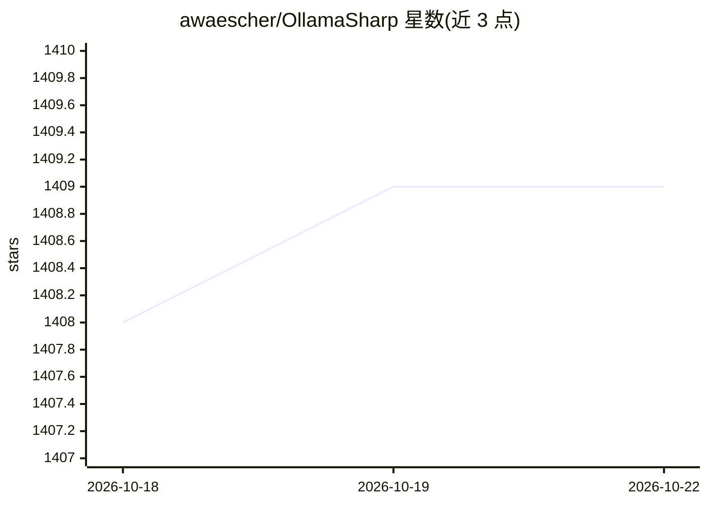

# awaescher/OllamaSharp

⭐ 1,409 · C# · MIT · 推送 2026-09-30 · [GitHub](https://github.com/awaescher/OllamaSharp) · [官网](https://www.nuget.org/packages/OllamaSharp) · 个人维护

**.NET 访问 Ollama API 的绑定库**

为 .NET 提供的 Ollama API 客户端库，将每个 Ollama 端点封装为支持流式响应的异步方法，覆盖聊天、生成、嵌入、模型列表/拉取/创建、进度报告、工具调用（source generator）与视觉模型。同时实现 Microsoft.Extensions.AI 的 IChatClient 与 IEmbeddingGenerator 接口，可作为统一抽象下使用 Ollama 的通道，也支持 Ollama 云端模型（Turbo）与 Native AOT。以 NuGet 包分发，仓库内附带完整示例应用。

## 筛选速览

| 维度 | 判定 | 备注 |
|---|---|---|
| AI 角色 | `ai-ecosystem` | LLM/agent 周边工具 |
| 许可风险 | `permissive` | MIT |
| 部署形态 | `None` |  |
| 模型依赖 | local-ok | 支持本地模型 |
| 硬件要求 | — | 无带数字的原话,不猜 |
| 安装摩擦 | `low` | 无编译、无系统依赖或容器化 |
| 成熟度 | — | 结构信号不足 |

## 能力要点

- 封装全部 Ollama API 端点，含流式响应与拉取进度报告
- Microsoft.Extensions.AI 的 IChatClient/IEmbeddingGenerator 实现
- 工具调用（function calling）与视觉模型支持
- 可选 Native AOT 与 Ollama 云端模型（Ollama Turbo）

## 适用场景

- 在 .NET 应用中接入本地或远程 Ollama 模型
- 通过统一 IChatClient 抽象在多 provider 间切换并保留 Ollama
- 在 C# 中管理 Ollama 模型（列表、拉取、推送、删除）

## 场景标签

 · 领域:LLM 基础设施/.NET 库

## 证据(README 行号)

> L7: OllamaSharp provides .NET bindings for the Ollama API, simplifying interactions with Ollama both locally and remotel
> L121: OllamaSharp is the first full implementation of their `IChatClient` and `IEmbeddingGenerator` that makes it possib

## 星数曲线

2026-10-18 1,408 → 2026-10-22 1,409（+1）

---
*卡片 v1 · prompt 1.4 · 生成 2026-10-21 · 置信度 high · 依据 README sha `fc84843dc7a5` · [字段定义](../../DATASET.md)*
