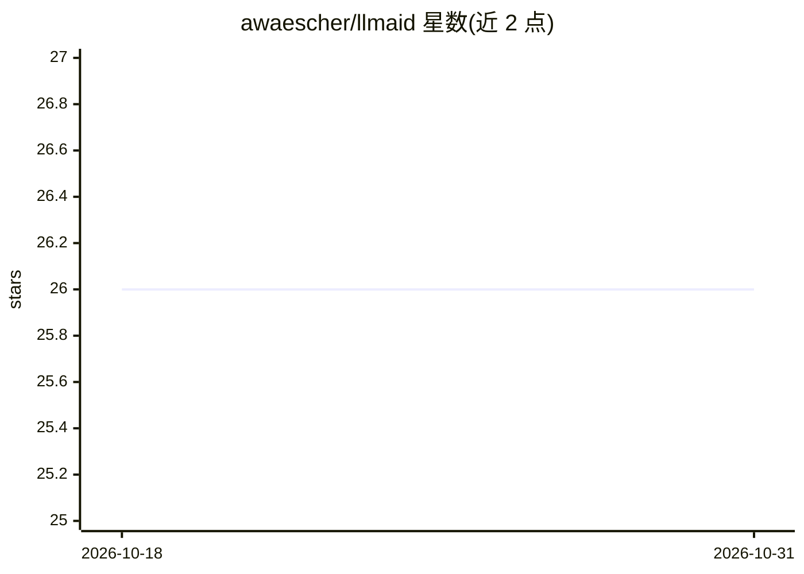

# awaescher/llmaid

⭐ 26 · C# · MIT · 推送 2026-06-02 · [GitHub](https://github.com/awaescher/llmaid) · 个人维护

**用 LLM 批量改写/审查整个代码库文件的命令行工具**

llmaid 是 .NET 编写的命令行工具：遍历指定路径下的每个文本或图像文件，逐文件发送给 LLM（Ollama、LM Studio、OpenAI、MiniMax 或任意 OpenAI 兼容端点），把模型回答输出到控制台或直接写回文件，实现批量修错字、补文档、审查用语等任务。任务以 YAML profile 定义（模型、文件模式、系统提示），配置分 appsettings/profile/CLI 三层覆盖；可选 Judge 第二次 LLM 调用按 response/git-diff/both 三种模式校验输出并触发重试。README 声明与 GitHub Copilot、Cursor 等自主 agent 定位不同：每个文件都是独立对话，无自主导航。

## 筛选速览

| 维度 | 判定 | 备注 |
|---|---|---|
| AI 角色 | `ai-native` | 本体是模型或模型工具 |
| 许可风险 | `permissive` | MIT |
| 部署形态 | `None` |  |
| 模型依赖 | local-ok | 支持本地模型 |
| 硬件要求 | — | 无带数字的原话,不猜 |
| 安装摩擦 | `medium` | 含编译或系统依赖之一 |
| 成熟度 | — | 结构信号不足 |

## 能力要点

- 逐文件发送 LLM 并支持将回答写回原文件（applyCodeblock）
- 支持 ollama/lmstudio/openai/minimax/openai-compatible 五种 provider
- YAML profile 任务定义 + 三层配置覆盖 + dryRun/resumeAt 断点续跑
- 可选 Judge 质量门：第二次 LLM 调用按 response/git-diff/both 校验并可重试

## 适用场景

- 给整个仓库的代码文件批量补充或修正文档注释
- 批量扫描并修正代码中的不专业用语
- 为图片批量生成 alt 文本或品牌检测报告

## 场景标签

`代码审查` `代码生成` · 领域:编码与开发

## 证据(README 行号)

> L5: llmaid is a command-line tool designed to automate the process of AI supported file changes using large language mod
> L17: llmaid is different: Every file is a new conversation. While there is no autonomous intelligence, it can review or 

## 星数曲线

2026-10-18 26 → 2026-10-31 26（+0）

---
*卡片 v1 · prompt 1.4 · 生成 2026-10-26 · 置信度 high · 依据 README sha `85a8539ef011` · [字段定义](../../DATASET.md)*
