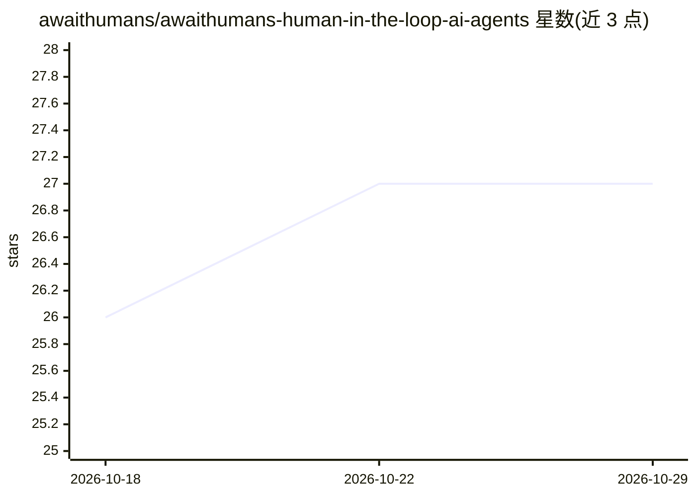

# awaithumans/awaithumans-human-in-the-loop-ai-agents

⭐ 27 · Python · Apache-2.0 · 推送 2026-10-20 · [GitHub](https://github.com/awaithumans/awaithumans-human-in-the-loop-ai-agents) · [官网](https://awaithumans.dev) · 组织维护

**为生产级 AI agent 提供人机协同审批的开源 HITL 基础设施库**

为 LLM agent 提供 await_human() 单一原语：agent 遇到需人工判断的场景时挂起，真人通过 Slack、邮件或内置 dashboard 审查任务并提交 Pydantic/Zod 类型化响应，agent 随即恢复执行。提供 Temporal 与 LangGraph 持久化适配器（跨重启幂等恢复）、AI 预校验器（Claude/OpenAI/Gemini/Azure）、审计日志与路由分配。Python 和 TypeScript 双 SDK，Docker 一命令自托管，Apache 2.0 许可；另在其上销售 AwaitVerify 托管文档核验服务（$0.80/页）。v0.1.0 公开预览版。

## 筛选速览

| 维度 | 判定 | 备注 |
|---|---|---|
| AI 角色 | `ai-ecosystem` | LLM/agent 周边工具 |
| 许可风险 | `permissive` | Apache-2.0 |
| 部署形态 | `self-host` | docker 或自建部署 |
| 模型依赖 | locked-api |  |
| 硬件要求 | — | 无带数字的原话,不猜 |
| 安装摩擦 | `low` | 无编译、无系统依赖或容器化 |
| 成熟度 | `idea` | |

## 能力要点

- await_human() 单原语：Slack/邮件/dashboard 人工审查后返回类型化响应
- Temporal 与 LangGraph 持久化适配器，agent 跨重启幂等恢复
- AI 预校验器（Claude/OpenAI/Gemini/Azure OpenAI）复核人工提交
- Docker 一命令自托管，SQLite（开发）/Postgres（生产）任务存储与审计日志

## 适用场景

- 高价值操作（退款、转账、KYC）上线前强制人工审批
- 内容审核与客服场景中 agent 触发人工升级
- 自动化流程遇 CAPTCHA 等物理障碍时转人工处理后继续

## 场景标签

`Agent 框架` · 领域:Agent 开发

## 证据(README 行号)

> L20: **HITL infrastructure for AI agents — open source.** A single primitive (`await_human()` / `awaitHuman()`) your age
> L67: |**Workflow engines**|✅ Temporal + LangGraph adapters — hand the wait to the engine|❌|Build each yourself|
> L225: - **Core primitive:** one function, `await_human()` / `awaitHuman()`,

## 星数曲线

2026-10-18 26 → 2026-10-29 27（+1）

---
*卡片 v1 · prompt 1.4 · 生成 2026-10-26 · 置信度 high · 依据 README sha `d1fb0f7744e6` · [字段定义](../../DATASET.md)*
