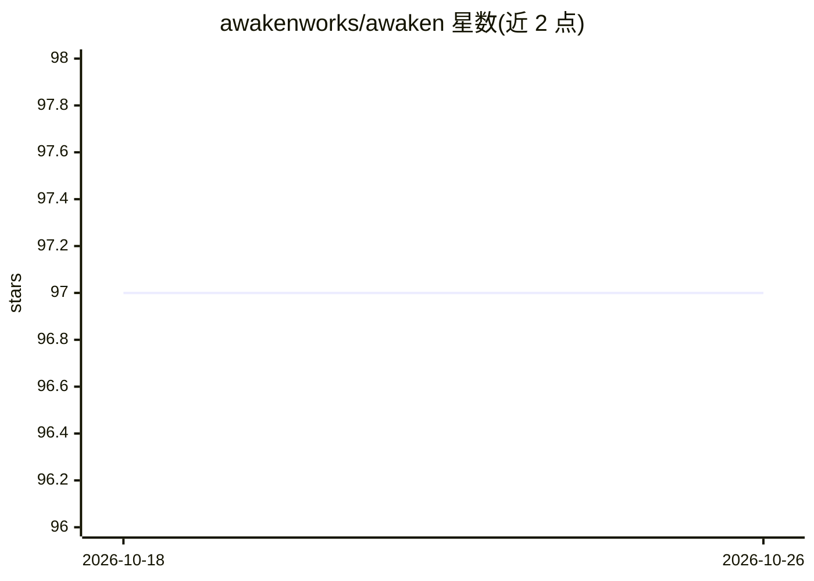

# awakenworks/awaken

⭐ 97 · Rust · NOASSERTION · 推送 2026-09-04 · [GitHub](https://github.com/awakenworks/awaken) · [官网](https://awakenworks.github.io/awaken/) · 组织维护 · 中文 README

**Rust 编写的 AI agent 运行时：多协议服务与在线调优**

面向 Rust 开发者的 AI agent 运行时与服务器控制平面：以类型化状态、类型化工具与原子提交组织 agent 执行循环，通过 AI SDK v6、AG-UI/CopilotKit、A2A、MCP、ACP 五种协议适配器从单一后端服务多种客户端。提示词、模型绑定、权限规则、技能与评测循环可通过 Admin Console 或 /v1/config/* 在线调整而无需改代码；运行时提供 HITL 挂起、trace、回放、数据集与 eval。不含内置文件/shell/web 工具，需要 Rust 1.93+。

## 筛选速览

| 维度 | 判定 | 备注 |
|---|---|---|
| AI 角色 | `ai-ecosystem` | LLM/agent 周边工具 |
| 许可风险 | `none` | NOASSERTION |
| 部署形态 | `library` | 以包/库形式分发 |
| 模型依赖 | — | README 未给出锁定关系 |
| 硬件要求 | — | 无带数字的原话,不猜 |
| 安装摩擦 | `low` | 无编译、无系统依赖或容器化 |
| 成熟度 | — | 结构信号不足 |

## 能力要点

- 单一后端同时服务 AI SDK v6、AG-UI、A2A、MCP、ACP 五种协议
- 提示词/模型绑定/权限/技能等通过管理配置在线调整，代码保持稳定
- 类型化状态与 TypedTool，并发工具执行可审计
- durable dispatch、HITL mailbox 挂起、trace 回放、数据集与 eval 运行

## 适用场景

- 在 Rust 后端构建并运行多协议 AI agent 服务
- 上线后由运维人员在线调优提示词、模型与权限规则
- 需要审批（HITL）、trace 与可回放审计的 agent 工作流

## 场景标签

`Agent 框架` · 领域:Agent 开发

## 证据(README 行号)

> L7: Build agent capability in Rust. Tune prompts, models, permissions, skills, and eval loops live. Serve AI SDK, AG-UI,
> L39: - **One backend serves many clients.** AI SDK v6, AG-UI / CopilotKit, A2A, MCP, and ACP are adapters over the same 
> L62: |**Runtime library**|`awaken` / `awaken-runtime`|HTTP/UI/job scheduling, auth, config storage, concrete tools/provi

## 星数曲线

2026-10-18 97 → 2026-10-26 97（+0）

---
*卡片 v1 · prompt 1.4 · 生成 2026-10-23 · 置信度 high · 依据 README sha `513c5f16cf2a` · [字段定义](../../DATASET.md)*
