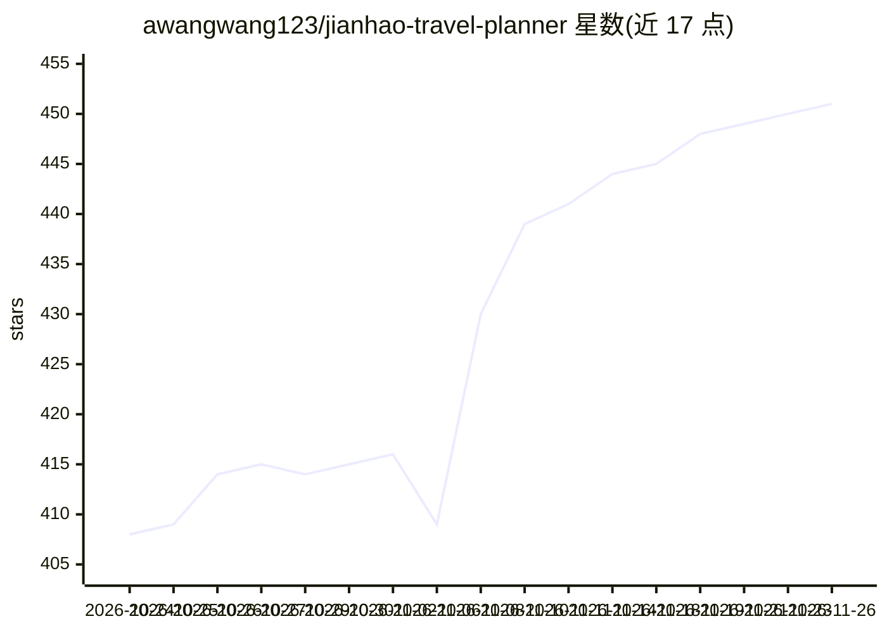

# awangwang123/jianhao-travel-planner

⭐ 451 · Python · MIT · 推送 2026-11-16 · [GitHub](https://github.com/awangwang123/jianhao-travel-planner) · 个人维护 · 中文 README

**给旅行者用 AI 按固定流程制作可核验的旅行路书**

一套「出行路书」工作流技能包：用户说出出行意图后，AI 按 SKILL.md 固定流程采集需求、联网实查并多源交叉验证，产出 md 事实源与单文件 HTML 路书（本地完整版断网可开 + 可选一键部署在线版），附美食情报卡。内置 checklist.py 等机械检查工具供交稿前与交付时验收；也可不经 AI 走 tools/pipeline.py 工具链按 schema 直接生成。依赖仅 Python 3.8+ 标准库，Playwright 为可选视觉检查依赖。

## 筛选速览

| 维度 | 判定 | 备注 |
|---|---|---|
| AI 角色 | `ai-native` | 本体是模型或模型工具 |
| 许可风险 | `permissive` | MIT |
| 部署形态 | `None` |  |
| 模型依赖 | — | README 未给出锁定关系 |
| 硬件要求 | — | 无带数字的原话,不猜 |
| 安装摩擦 | `low` | 无编译、无系统依赖或容器化 |
| 成熟度 | — | 结构信号不足 |

## 能力要点

- 联网实查带来源，大众点评+高德+小红书交叉验证
- 交付前强制运行 checklist.py 机械检查，FAIL 清零才交付
- 单文件 HTML 双版本：断网可开的本地版 + 可一键部署的在线版
- 工具模式：按 schema 填 trip_data.json，四步工具链直接生成路书

## 适用场景

- 周末出行前让 AI 生成一份逐日行程路书
- 出境旅行需要出入境、支付、双币种预算的标准化攻略
- 不想走 AI 流程时用工具链按 schema 直接生成路书

## 场景标签

 · 领域:旅行/内容生成

## 证据(README 行号)

> L21: 一套「出行路书」工作流：你说"想出去玩"，它按固定流程采集需求 → 联网实查 → 产出**路书**（md 事实源 + 单文件 HTML 双版本：本地完整版断网可开 + 瘦身在线版一键部署）+ **美食情报卡**（按城市持续追加的数
> L66: 安装后，跟 AI 说这些话会自动触发本 Skill：

## 星数曲线

2026-10-24 408 → 2026-11-26 451（+43）

---
*卡片 v1 · prompt 1.4 · 生成 2026-11-25 · 置信度 high · 依据 README sha `3c9015386251` · [字段定义](../../DATASET.md)*
