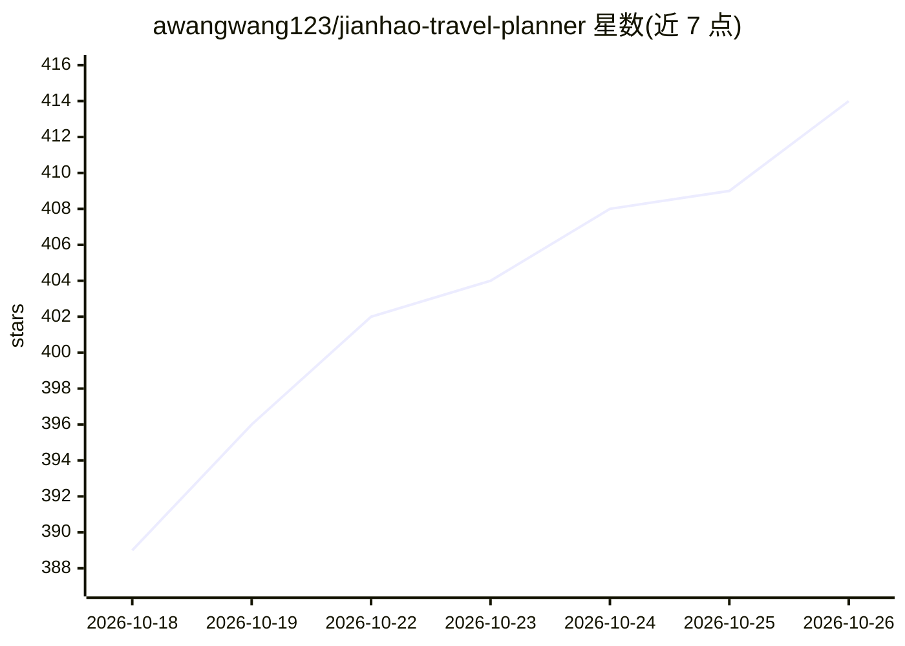

# awangwang123/jianhao-travel-planner

⭐ 414 · HTML · MIT · 推送 2026-10-24 · [GitHub](https://github.com/awangwang123/jianhao-travel-planner) · 个人维护 · 中文 README

**旅行路书生成 Skill：联网实查产出可核验的单文件 HTML 攻略**

面向 Claude Code 及其他能读文件、联网的 AI 助手的技能包（SKILL.md 工作流 + 基准骨架 + 校验脚本）。按固定流程采集需求、联网实查并用大众点评/高德/小红书交叉验证，产出断网可开的单文件 HTML 路书（含行程、路程、门票、住宿、预算、应急、美食等十大板块）、可选瘦身在线版与按城市累积的美食情报卡。内置 checklist.py 等机械检查脚本验收交付；图源支持 Wikimedia Commons、Pexels、AI 生图三级链；安装为文件夹拷入 skills 目录，不绑定特定 AI。

## 筛选速览

| 维度 | 判定 | 备注 |
|---|---|---|
| AI 角色 | `ai-native` | 本体是模型或模型工具 |
| 许可风险 | `permissive` | MIT |
| 部署形态 | `None` |  |
| 模型依赖 | — | README 未给出锁定关系 |
| 硬件要求 | — | 无带数字的原话,不猜 |
| 安装摩擦 | `low` | 无编译、无系统依赖或容器化 |
| 成熟度 | — | 结构信号不足 |

## 能力要点

- SKILL.md 工作流驱动：阶段 0 需求提问 → 联网实查 → 多源交叉验证
- 产出断网可开的单文件 HTML 路书，十大板块 + 美食情报卡
- 内置 checklist.py / consistency.py / desource.py 机械校验与脱敏脚本
- 图源三级链：Wikimedia Commons → Pexels → AI 生图（标注示意）

## 适用场景

- 让 AI 助手按固定流程帮我做一份可核验的旅行攻略
- 出境游前获取含签证/双币种预算/领保应急的路书
- 用检查脚本验收 AI 产出的路书质量

## 场景标签

 · 领域:旅行规划/Agent 技能

## 证据(README 行号)

> L19: 一套「出行路书」工作流：你说"想出去玩"，它按固定流程采集需求 → 联网实查 → 产出**路书**（md 事实源 + 单文件 HTML 双版本：本地完整版断网可开 + 瘦身在线版一键部署）+ **美食情报卡**（按城市持续追加的数
> L86: ### 不用 Claude Code？任意 AI 助手都能用

## 星数曲线

2026-10-18 389 → 2026-10-26 414（+25）

---
*卡片 v1 · prompt 1.4 · 生成 2026-10-21 · 置信度 high · 依据 README sha `db8a17323069` · [字段定义](../../DATASET.md)*
