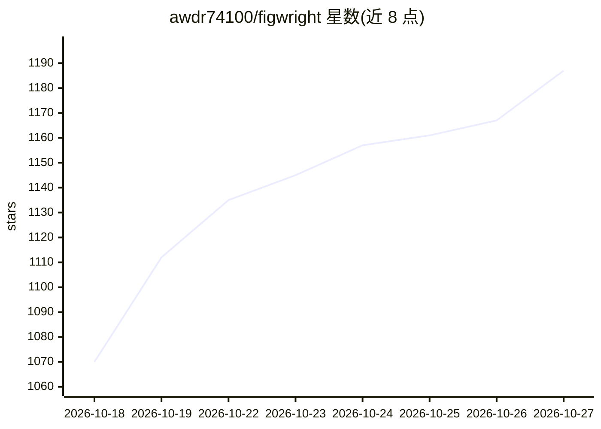

# awdr74100/figwright

⭐ 1,187 · TypeScript · MIT · 推送 2026-10-26 · [GitHub](https://github.com/awdr74100/figwright) · 个人维护

**给编码 agent 的双向 Figma MCP 服务器：设计转代码、代码回写画布**

Figwright 是一个 MCP 服务器，通过本地 WebSocket 中继连接一个 Figma 插件，使 Claude Code、Cursor、Codex 等 MCP 客户端里的 AI agent 能读取 Figma 选区生成贴合项目技术栈的代码，并反向在画布上创建/编辑帧、文本、自动布局、组件、动效等。共暴露 125 个 MCP 工具，含设计上下文接地与 design_diff；配合可安装的 agent skills 使用。需要 Node.js 20.19+/22.12+ 与 Figma 免费版桌面端，全部在本机运行，数据不外发。限制：插件暂未上架 Figma Community，需从 GitHub Release 手动导入。

## 筛选速览

| 维度 | 判定 | 备注 |
|---|---|---|
| AI 角色 | `ai-ecosystem` | LLM/agent 周边工具 |
| 许可风险 | `permissive` | MIT |
| 部署形态 | `library` | 以包/库形式分发 |
| 模型依赖 | — | README 未给出锁定关系 |
| 硬件要求 | — | 无带数字的原话,不猜 |
| 安装摩擦 | `low` | 无编译、无系统依赖或容器化 |
| 成熟度 | — | 结构信号不足 |

## 能力要点

- 125 个 MCP 工具，覆盖读取与写入 Figma 画布
- 双向工作流：Figma 选区转框架感知代码 / 从代码或描述构建设计
- 检测项目实际技术栈并复用已有组件、tokens、图标
- 完全本机运行（stdio + 127.0.0.1 WebSocket），设计数据不外发

## 适用场景

- 让编码 agent 把选中的 Figma 设计转成贴合我项目栈的组件
- 用 agent 直接在 Figma 画布上搭建界面
- 设计变更后只更新受影响的代码（design_diff）

## 场景标签

`代码生成` · 领域:编码与开发

## 证据(README 行号)

> L17: Figwright connects an **MCP server** to a **Figma plugin** over a local WebSocket relay, so an AI agent (Claude Cod
> L106: Figwright exposes **125 MCP tools** in three groups:

## 星数曲线

2026-10-18 1,070 → 2026-10-27 1,187（+117）

---
*卡片 v1 · prompt 1.4 · 生成 2026-10-21 · 置信度 high · 依据 README sha `596d29b1a202` · [字段定义](../../DATASET.md)*
