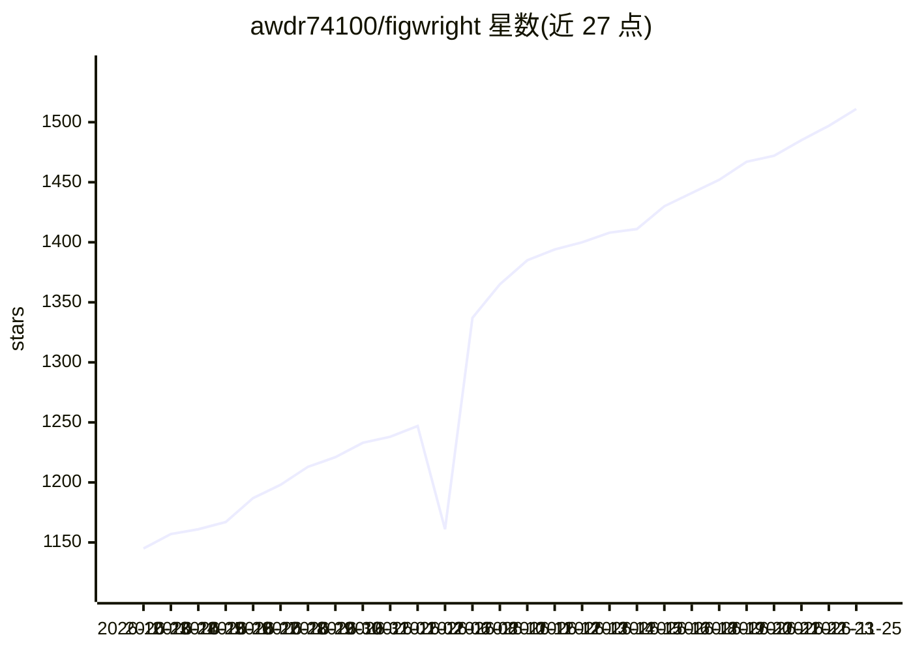

# awdr74100/figwright

⭐ 1,511 · TypeScript · MIT · 推送 2026-11-23 · [GitHub](https://github.com/awdr74100/figwright)

**双向 Figma MCP 服务器：设计转代码、代码回写画布**

通过本地 WebSocket 中继连接 MCP 服务器与 Figma 插件，让 Claude Code、Cursor、Codex 等 MCP 客户端读写 Figma 画布：读取方向将选区转为贴合项目框架与样式体系的代码，写入方向支持直接创建编辑 frame、文本、auto-layout、组件、变量等，共 147 个工具。提供两个可安装的 agent skills。全部进程在本机运行，免费 Figma 档即可使用，不需要付费 Dev Mode 席位。

## 筛选速览

| 维度 | 判定 | 备注 |
|---|---|---|
| AI 角色 | `ai-ecosystem` | LLM/agent 周边工具 |
| 许可风险 | `permissive` | MIT |
| 部署形态 | `library` | 以包/库形式分发 |
| 模型依赖 | — | README 未给出锁定关系 |
| 硬件要求 | — | 无带数字的原话,不猜 |
| 安装摩擦 | `low` | 无编译、无系统依赖或容器化 |
| 成熟度 | — | 结构信号不足 |

## 能力要点

- 双向 147 个 MCP 工具，覆盖读取与写入画布
- 读取选区生成感知框架与样式体系的代码
- 多 agent 各占用一个文件并行工作
- 本机运行，设计数据不外发

## 适用场景

- 把 Figma 设计稿转成 React 等框架组件代码
- 在 Figma 画布上直接搭建页面或定价区块
- 复用现有代码库的组件、tokens 与图标

## 场景标签

`代码生成` · 领域:编码与开发

## 证据(README 行号)

> L3:  A free, two-way Figma MCP server for coding agents.
> L17: Figwright connects an **MCP server** to a **Figma plugin** over a local WebSocket relay, so an AI agent (Claude Cod
> L34: - **Bidirectional**: not read-only. **147 tools** span reading _and_ writing the canvas, so an agent can both imple

## 星数曲线

2026-10-23 1,145 → 2026-11-25 1,511（+366）

---
*卡片 v1 · prompt 1.4 · 生成 2026-11-23 · 置信度 high · 依据 README sha `d830cb970e21` · [字段定义](../../DATASET.md)*
