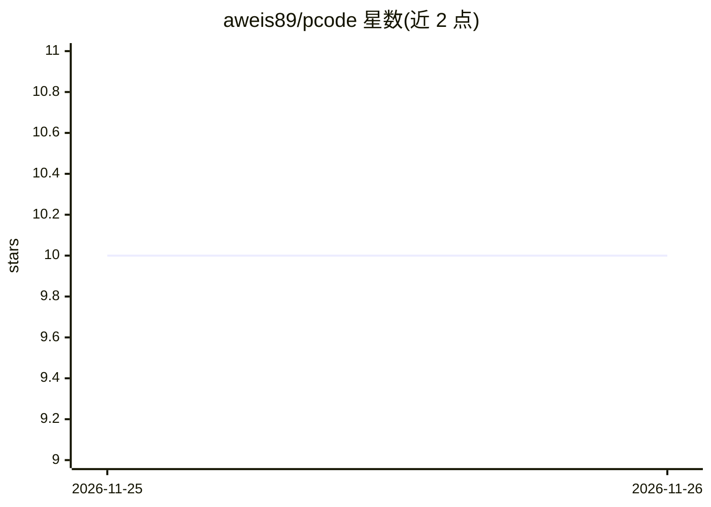

# aweis89/pcode

⭐ 10 · Python · MIT · 推送 2026-11-25 · [GitHub](https://github.com/aweis89/pcode) · [官网](https://aweis89.github.io/pcode/) · 个人维护

**终端原生 AI 编码代理：并行运行多个 agent 会话**

基于 Pydantic AI 构建的终端编码 agent，可通过官方 SDK/CLI 使用 Claude、Antigravity、ChatGPT 订阅，或接入 25+ API 提供商。核心机制包括：git worktree 自动隔离每个会话、后台会话宿主与会话分叉、Conductor 多会话编排、子代理可视化与 Manager 模式、后台长任务追踪与跨会话检索（SQLite FTS）。默认以用户权限直接改文件和执行命令，可选 macOS Seatbelt/Linux bwrap 的 OS 级沙箱。

## 筛选速览

| 维度 | 判定 | 备注 |
|---|---|---|
| AI 角色 | `ai-native` | 本体是模型或模型工具 |
| 许可风险 | `permissive` | MIT |
| 部署形态 | `library` | 以包/库形式分发 |
| 模型依赖 | locked-api |  |
| 硬件要求 | — | 无带数字的原话,不猜 |
| 安装摩擦 | `low` | 无编译、无系统依赖或容器化 |
| 成熟度 | — | 结构信号不足 |

## 能力要点

- 每个会话自动 git worktree 隔离，支持中途合并与未合并保护
- Conductor 编排多个会话，/agents 可视化子代理的工具调用与推理
- 长命令转为可跨重启存活的后台任务，完成后唤醒 agent
- 内置 /tools、/diffs、/btw、/tree 等检查器，滚动回溯可事后重渲染

## 适用场景

- 同时并行运行多个编码 agent 处理不同分支任务
- 用订阅账号（Claude/ChatGPT/Antigravity）以合规方式驱动编码代理
- 长时间运行测试/CI 并让 agent 自动跟进修复失败
- 跨会话检索历史决策与讨论记录

## 场景标签

`编码 Agent` `Agent 框架` · 领域:Agent 开发

## 证据(README 行号)

> L3: **A terminal-native coding agent built to run many agents in parallel—without the chaos.**
> L46: Running one coding agent is easy. Running five or ten at once breaks down fast: agents trample each other's git sta
> L94: Because `pcode` is built directly on Pydantic AI and Harness, extensions have the full power of Pydantic AI in plai

## 星数曲线

2026-11-25 10 → 2026-11-26 10（+0）

---
*卡片 v1 · prompt 1.4 · 生成 2026-11-24 · 置信度 mid · 依据 README sha `088a9ad88f4d` · [字段定义](../../DATASET.md)*
