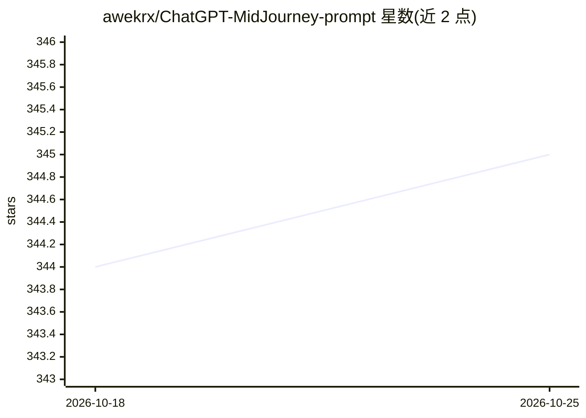

# awekrx/ChatGPT-MidJourney-prompt

⭐ 345 · Python · MIT · 推送 2026-05-27 · [GitHub](https://github.com/awekrx/ChatGPT-MidJourney-prompt) · 个人维护

**为 MidJourney 生成创意提示词的 Python 库**

基于 ChatGPT 的 MidJourney 提示词生成 Python 库：用户输入部分提示，由 LLM 续写生成完整 prompt，并提供配置属性控制模型版本（V5/V4/niji/testp）、画风类型、渲染器、内容类别、长宽比与颜色等。支持邮箱密码、token、api key 三种授权方式接入 ChatGPT，MiniMax 可作为替代 LLM 后端（OpenAI 兼容 API，含 M2.7/M2.5 系列、204K 上下文）。通过 pip 安装。

## 筛选速览

| 维度 | 判定 | 备注 |
|---|---|---|
| AI 角色 | `ai-native` | 本体是模型或模型工具 |
| 许可风险 | `permissive` | MIT |
| 部署形态 | `library` | 以包/库形式分发 |
| 模型依赖 | — | README 未给出锁定关系 |
| 硬件要求 | — | 无带数字的原话,不猜 |
| 安装摩擦 | `low` | 无编译、无系统依赖或容器化 |
| 成熟度 | — | 结构信号不足 |

## 能力要点

- 部分提示输入，由 LLM 续写生成 MidJourney prompt
- 可配置模型版本/画风/渲染器/内容/长宽比/颜色等属性
- 三种授权方式（邮箱密码/token/api key）
- MiniMax 可作为替代 LLM 后端（OpenAI 兼容 API）

## 适用场景

- 写不出完整 MidJourney 提示词时让 AI 续写补全
- 批量按指定风格与长宽比生成绘画提示词
- 换用 MiniMax 后端生成提示词

## 场景标签

`提示工程` · 领域:Agent 开发

## 证据(README 行号)

> L3: This is a ChatGPT based prompt generation model for MidJourney. The purpose of this model is to simplify the creatio
> L10: pip install chatGPTMidJourneyPrompt

## 星数曲线

2026-10-18 344 → 2026-10-25 345（+1）

---
*卡片 v1 · prompt 1.4 · 生成 2026-10-21 · 置信度 high · 依据 README sha `43ba143ff0bb` · [字段定义](../../DATASET.md)*
