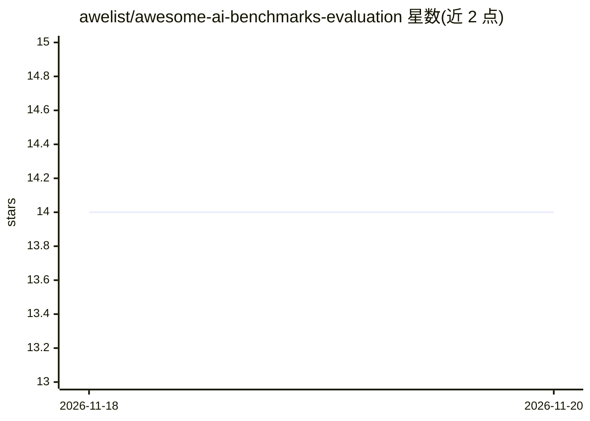

# awelist/awesome-ai-benchmarks-evaluation

⭐ 14 · Python · 推送 2026-11-18 · [GitHub](https://github.com/awelist/awesome-ai-benchmarks-evaluation) · [官网](https://lnktr.net/awesome) · 个人维护

**AI 模型评测基准与工具的资源清单（awesome list）**

一份策展型清单，汇总用于评估模型性能的资源，覆盖通用 LLM 基准、推理数学、多模态、RAG、安全鲁棒性、评测框架、数据集与学习资源等类别；条目以名称加一句简介的形式列出（HELM、GSM8K、RAGAS、OpenAI Evals 等），并附相关 awesome 列表链接与贡献规范。面向需要选择评测基准或评测框架的研究者与开发者，本身不包含代码或可运行的评测工具，采用 CC0 许可。

## 筛选速览

| 维度 | 判定 | 备注 |
|---|---|---|
| AI 角色 | `ai-knowledge` | 知识聚合/清单类 |
| 许可风险 | `none` | — |
| 部署形态 | `None` |  |
| 模型依赖 | — | README 未给出锁定关系 |
| 硬件要求 | — | 无带数字的原话,不猜 |
| 安装摩擦 | `low` | 无编译、无系统依赖或容器化 |
| 成熟度 | — | 结构信号不足 |

## 能力要点

- 按 8 个类别组织基准数据集、排行榜与评测框架条目
- 覆盖 LLM、推理数学、多模态、RAG、安全鲁棒性等领域
- 附学习资源（HELM 概览、HuggingFace 评测指南等）
- 以 CONTRIBUTING.md 规范社区贡献流程

## 适用场景

- 为我的模型选一套合适的评测基准
- 查找 RAG 或安全性方向的评测数据集与框架
- 了解模型评测领域的资源分布

## 场景标签

`模型评测` `RAG` `精选清单` · 领域:评测与运维

## 证据(README 行号)

> L12: > A curated list of evaluation tools, benchmark datasets, leaderboards, frameworks, and resources for assessing mod
> L16: ## Contents

## 星数曲线

2026-11-18 14 → 2026-11-20 14（+0）

---
*卡片 v1 · prompt 1.4 · 生成 2026-11-19 · 置信度 high · 依据 README sha `2e86b7d12b7e` · [字段定义](../../DATASET.md)*
