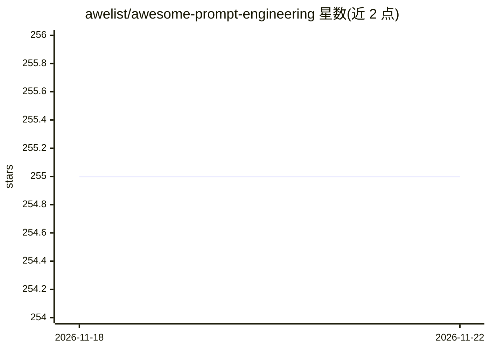

# awelist/awesome-prompt-engineering

⭐ 255 · Python · 推送 2026-11-02 · [GitHub](https://github.com/awelist/awesome-prompt-engineering) · [官网](https://lnktr.net/awesome) · 个人维护

**LLM 提示工程资源策展清单：指南、工具、论文与社区**

策展型 awesome 清单，汇集提示工程（prompt engineering）相关的指南、课程教程、提示词库、工具、研究论文、社区与应用案例。条目涵盖 OpenAI 与 Anthropic 官方指南、Learn Prompting 课程、LangChain/Promptfoo 等工具、GPT-3 等论文，以及 Reddit、Hugging Face 社区。面向需要学习或选用提示工程资源的 LLM 开发者与学习者。仓库以 CC0 许可发布，通过 PR 接受符合规范的贡献。

## 筛选速览

| 维度 | 判定 | 备注 |
|---|---|---|
| AI 角色 | `ai-knowledge` | 知识聚合/清单类 |
| 许可风险 | `none` | — |
| 部署形态 | `None` |  |
| 模型依赖 | — | README 未给出锁定关系 |
| 硬件要求 | — | 无带数字的原话,不猜 |
| 安装摩擦 | `low` | 无编译、无系统依赖或容器化 |
| 成熟度 | — | 结构信号不足 |

## 能力要点

- 按指南、课程、提示词库、工具、论文、社区等类别组织条目
- 收录 OpenAI / Anthropic / DeepLearning.AI 的官方与课程资源
- 条目含工具（LangChain、Promptfoo、flompt 等）与研究论文

## 适用场景

- 系统学习提示工程的概念与技术
- 查找提示词库、提示管理与评测工具
- 跟进提示工程相关论文与社区讨论

## 场景标签

`提示工程` `精选清单` · 领域:Agent 开发

## 证据(README 行号)

> L11: > A curated list of resources, tools, papers, and platforms for prompt engineering in large language models (LLMs) 
> L15: ## Contents

## 星数曲线

2026-11-18 255 → 2026-11-22 255（+0）

---
*卡片 v1 · prompt 1.4 · 生成 2026-11-18 · 置信度 high · 依据 README sha `056d4ee7645f` · [字段定义](../../DATASET.md)*
