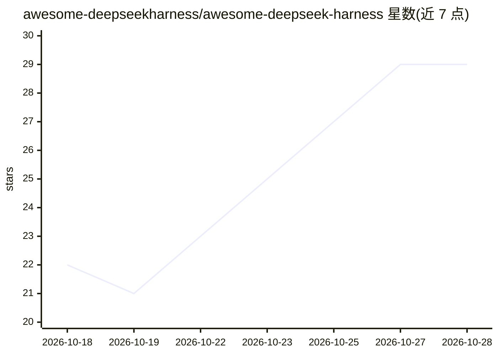

# awesome-deepseekharness/awesome-deepseek-harness

⭐ 29 · JavaScript · CC0-1.0 · 推送 2026-10-27 · [GitHub](https://github.com/awesome-deepseekharness/awesome-deepseek-harness) · [官网](https://awesome-deepseekharness.github.io/awesome-deepseek-harness/) · 组织维护 · 中文 README

**DeepSeek Harness (dsh) 插件与工具的社区精选清单**

社区维护的 DeepSeek Harness 插件目录，声明非官方 DeepSeek 产品。收录市场与发现、视觉、浏览器、记忆、Web UI 与桌面等类别的插件项目，每条含仓库、简介与 star 数。README 介绍 dsh 的插件化理念与四种模式（Standard/Code/Minimal/Creator），并提供 catalog.json 与 llms.txt 结构化访问方式，中英双语。官方发布处于 Developer Preview，插件契约可能变更。

## 筛选速览

| 维度 | 判定 | 备注 |
|---|---|---|
| AI 角色 | `ai-knowledge` | 知识聚合/清单类 |
| 许可风险 | `viral` | CC0-1.0 |
| 部署形态 | `library` | 以包/库形式分发 |
| 模型依赖 | — | README 未给出锁定关系 |
| 硬件要求 | — | 无带数字的原话,不猜 |
| 安装摩擦 | `low` | 无编译、无系统依赖或容器化 |
| 成熟度 | `idea` | |

## 能力要点

- 按市场、视觉、记忆、Web UI、桌面、工具等类别组织的插件目录
- 提供 catalog.json 与 llms.txt 结构化访问
- 介绍 dsh 四种模式（Standard/Code/Minimal/Creator）
- 中英双语，含可搜索插件目录网站

## 适用场景

- 为 dsh 查找视觉、记忆或桌面 UI 等插件
- 了解 DeepSeek Harness 插件生态的覆盖范围
- 通过 dsh-plugin topic 发布并让自己的插件被收录

## 场景标签

`精选清单` · 领域:学习与行业

## 证据(README 行号)

> L5: A curated collection of the best plugins, tools, skills, and resources built for DeepSeek Harness (`dsh`) — the open
> L28: This is an independent, community-maintained directory, not an official DeepSeek product. Start with the searchable
> L41: ## 📦 Plugins (The Core)

## 星数曲线

2026-10-18 22 → 2026-10-28 29（+7）

---
*卡片 v1 · prompt 1.4 · 生成 2026-10-26 · 置信度 mid · 依据 README sha `27baab602b1b` · [字段定义](../../DATASET.md)*
