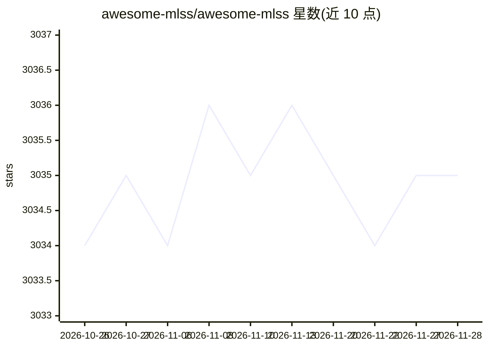

# awesome-mlss/awesome-mlss

⭐ 3,035 · HTML · MIT · 推送 2026-11-24 · [GitHub](https://github.com/awesome-mlss/awesome-mlss) · [官网](https://awesome-mlss.com) · 组织维护

**全球机器学习暑期学校截止日期追踪清单**

社区维护的 awesome-mlss.com 项目，集中收录全球机器学习及相关领域暑期学校的报名截止日期，README 按即将截止/即将开课两周窗口列出条目，完整列表在网站上维护，过期学校存入网页存档。面向希望报名暑期 school 的学生与研究者，也接受主办方通过 issue 或邮件提交新条目，项目采用 MIT 许可并托管于 Netlify。

## 筛选速览

| 维度 | 判定 | 备注 |
|---|---|---|
| AI 角色 | `ai-knowledge` | 知识聚合/清单类 |
| 许可风险 | `permissive` | MIT |
| 部署形态 | `None` |  |
| 模型依赖 | — | README 未给出锁定关系 |
| 硬件要求 | — | 无带数字的原话,不猜 |
| 安装摩擦 | `low` | 无编译、无系统依赖或容器化 |
| 成熟度 | — | 结构信号不足 |

## 能力要点

- 按报名截止与开课时间列出近期暑期学校条目
- 条目含主题、地点、截止日期、日期与详情链接
- 过期学校信息保留在网页存档
- 社区贡献机制：issue 提交或主办方邮件收录

## 适用场景

- 查找近期可报名的机器学习暑期学校及其截止日期
- 追踪全球 ML/AI 学术培训活动的时间安排
- 作为主办方提交自己的暑期学校收录申请

## 场景标签

`精选清单` · 领域:学习与行业

## 证据(README 行号)

> L7:  A community project to keep track of deadlines for Machine Learning Summer Schools (MLSS) around the world
> L16: awesome-mlss.com is a community tool which serves as a central repository for registration deadlines at summer scho

## 星数曲线

2026-10-26 3,034 → 2026-11-28 3,035（+1）

---
*卡片 v1 · prompt 1.4 · 生成 2026-11-26 · 置信度 high · 依据 README sha `84b9b0d10a35` · [字段定义](../../DATASET.md)*
